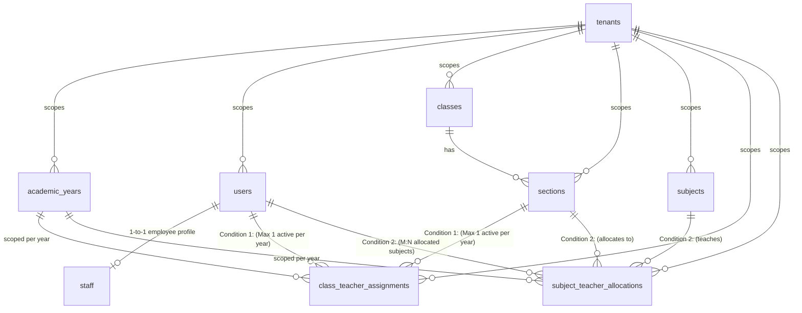

# Multi-Tenant Teacher Assignment Schema Architecture: Administrative (Class Teacher) vs. Instructional (Subject Teacher)

## 1. Architectural Review & Design Rationale

To support a dual-role teacher model in a Multi-Tenant School ERP, the database must cleanly separate two fundamentally distinct business relationships without duplicating the core employee/user identity:

1. **Administrative Homeroom Link (Condition 1 — Class Teacher)**:
   - **Cardinality**: Bijective 1-to-1 (or 1-to-0..1) per academic year within a tenant.
   - **Rule**: A single teacher can be the Class Teacher of **at most ONE** Section per academic year. Conversely, a Section can have **at most ONE** Class Teacher per academic year.
   - **Why a dedicated assignment table is superior to a column on `sections`**:
     In a school ERP, `classes` (e.g. *Grade 9*) and `sections` (e.g. *Section A*) are perpetual structural entities that persist across years. If `class_teacher_id` is placed directly as a column on `sections`:
     - You cannot retain historical records of who was the Class Teacher in previous academic years.
     - You cannot enforce the constraint *"A teacher can only be Class Teacher for one section in 2026-2027, but had another section in 2025-2026"* without complex partial indexes or schema duplication.
     - Mid-year substitutions (e.g., medical leave) would erase audit trails.
     - **Solution**: A dedicated `class_teacher_assignments` table with composite unique constraints on `(tenant_id, academic_year_id, teacher_id)` and `(tenant_id, academic_year_id, section_id)`.

2. **Instructional Timetable Link (Condition 2 — Subject Teacher)**:
   - **Cardinality**: Many-to-Many ($M:N$) across Classes, Sections, Subjects, and Teachers.
   - **Rule**: The **SAME** teacher can be allocated to teach *Mathematics* in 8-A, 8-B, 9-A, 9-B, and *Physics* in 10-A.
   - **Solution**: A junction table `subject_teacher_allocations` (or `section_subject_teachers`) with a unique constraint on active allocations per `(tenant_id, academic_year_id, section_id, subject_id)`.

3. **Multi-Tenancy & Single Identity (Condition 3)**:
   - Every table enforces a non-nullable `tenant_id` (or `school_id`) with composite foreign keys.
   - The user/staff identity lives in a single `users` / `staff` record per school. Both administrative and instructional assignments reference the exact same `users.id`.

---

## 2. Entity-Relationship Diagram (Mermaid)



---

## 3. Production PostgreSQL DDL

```sql
-- =============================================================================
-- 1. EXTENSIONS & ENUMS
-- =============================================================================
CREATE EXTENSION IF NOT EXISTS "uuid-ossp";

CREATE TYPE subject_type_enum AS ENUM ('CORE', 'ELECTIVE', 'CO_CURRICULAR', 'VOCATIONAL');
CREATE TYPE assignment_status_enum AS ENUM ('ACTIVE', 'TRANSFERRED', 'ON_LEAVE', 'COMPLETED');

-- =============================================================================
-- 2. TENANTS & ACADEMIC YEARS
-- =============================================================================
CREATE TABLE tenants (
    id UUID PRIMARY KEY DEFAULT uuid_generate_v4(),
    slug VARCHAR(63) NOT NULL UNIQUE,
    name VARCHAR(255) NOT NULL,
    is_active BOOLEAN NOT NULL DEFAULT TRUE,
    created_at TIMESTAMPTZ NOT NULL DEFAULT NOW(),
    updated_at TIMESTAMPTZ NOT NULL DEFAULT NOW()
);

CREATE TABLE academic_years (
    id UUID PRIMARY KEY DEFAULT uuid_generate_v4(),
    tenant_id UUID NOT NULL REFERENCES tenants(id) ON DELETE RESTRICT,
    name VARCHAR(50) NOT NULL,             -- e.g. "2026-2027"
    start_date DATE NOT NULL,
    end_date DATE NOT NULL,
    is_active BOOLEAN NOT NULL DEFAULT TRUE,
    created_at TIMESTAMPTZ NOT NULL DEFAULT NOW(),
    updated_at TIMESTAMPTZ NOT NULL DEFAULT NOW(),
    CONSTRAINT uq_academic_year_per_tenant UNIQUE (tenant_id, name)
);

-- =============================================================================
-- 3. CORE IDENTITY (USERS & STAFF) - NO DUPLICATION
-- =============================================================================
CREATE TABLE users (
    id UUID PRIMARY KEY DEFAULT uuid_generate_v4(),
    tenant_id UUID NOT NULL REFERENCES tenants(id) ON DELETE RESTRICT,
    email VARCHAR(255) NOT NULL,
    password_hash VARCHAR(255) NOT NULL,
    first_name VARCHAR(100) NOT NULL,
    last_name VARCHAR(100) NOT NULL,
    role VARCHAR(50) NOT NULL DEFAULT 'TEACHER', -- Base system role
    is_active BOOLEAN NOT NULL DEFAULT TRUE,
    created_at TIMESTAMPTZ NOT NULL DEFAULT NOW(),
    updated_at TIMESTAMPTZ NOT NULL DEFAULT NOW(),
    CONSTRAINT uq_user_email_per_tenant UNIQUE (tenant_id, email)
);

CREATE TABLE staff (
    id UUID PRIMARY KEY DEFAULT uuid_generate_v4(),
    tenant_id UUID NOT NULL REFERENCES tenants(id) ON DELETE RESTRICT,
    user_id UUID NOT NULL UNIQUE REFERENCES users(id) ON DELETE RESTRICT,
    employee_code VARCHAR(50) NOT NULL,
    designation VARCHAR(100) NOT NULL DEFAULT 'Teacher',
    department VARCHAR(100) DEFAULT 'Academics',
    joining_date DATE NOT NULL,
    created_at TIMESTAMPTZ NOT NULL DEFAULT NOW(),
    updated_at TIMESTAMPTZ NOT NULL DEFAULT NOW(),
    CONSTRAINT uq_staff_employee_code_per_tenant UNIQUE (tenant_id, employee_code)
);

-- =============================================================================
-- 4. ACADEMIC STRUCTURE (CLASSES, SECTIONS, SUBJECTS)
-- =============================================================================
CREATE TABLE classes (
    id UUID PRIMARY KEY DEFAULT uuid_generate_v4(),
    tenant_id UUID NOT NULL REFERENCES tenants(id) ON DELETE RESTRICT,
    name VARCHAR(50) NOT NULL,             -- e.g. "Grade 9", "Class 10"
    grade_level INT NOT NULL,              -- 9, 10, 11, 12
    display_order INT NOT NULL DEFAULT 0,
    created_at TIMESTAMPTZ NOT NULL DEFAULT NOW(),
    updated_at TIMESTAMPTZ NOT NULL DEFAULT NOW(),
    CONSTRAINT uq_class_name_per_tenant UNIQUE (tenant_id, name)
);

CREATE TABLE sections (
    id UUID PRIMARY KEY DEFAULT uuid_generate_v4(),
    tenant_id UUID NOT NULL REFERENCES tenants(id) ON DELETE RESTRICT,
    class_id UUID NOT NULL REFERENCES classes(id) ON DELETE RESTRICT,
    name VARCHAR(20) NOT NULL,             -- e.g. "A", "B", "C"
    capacity INT NOT NULL DEFAULT 40,
    room_number VARCHAR(50),
    is_active BOOLEAN NOT NULL DEFAULT TRUE,
    created_at TIMESTAMPTZ NOT NULL DEFAULT NOW(),
    updated_at TIMESTAMPTZ NOT NULL DEFAULT NOW(),
    CONSTRAINT uq_section_per_class UNIQUE (class_id, name)
);

CREATE TABLE subjects (
    id UUID PRIMARY KEY DEFAULT uuid_generate_v4(),
    tenant_id UUID NOT NULL REFERENCES tenants(id) ON DELETE RESTRICT,
    code VARCHAR(50) NOT NULL,             -- e.g. "MATH_01", "PHY_02"
    name VARCHAR(100) NOT NULL,            -- e.g. "Mathematics", "Physics"
    subject_type subject_type_enum NOT NULL DEFAULT 'CORE',
    max_marks INT NOT NULL DEFAULT 100,
    passing_marks INT NOT NULL DEFAULT 33,
    is_active BOOLEAN NOT NULL DEFAULT TRUE,
    created_at TIMESTAMPTZ NOT NULL DEFAULT NOW(),
    updated_at TIMESTAMPTZ NOT NULL DEFAULT NOW(),
    CONSTRAINT uq_subject_code_per_tenant UNIQUE (tenant_id, code)
);

-- =============================================================================
-- 5. CONDITION 1: CLASS TEACHER ASSIGNMENTS (ADMINISTRATIVE / HOMEROOM)
--    Enforces:
--    a) A Teacher is Class Teacher of AT MOST ONE Section per academic year.
--    b) A Section has AT MOST ONE active Class Teacher per academic year.
-- =============================================================================
CREATE TABLE class_teacher_assignments (
    id UUID PRIMARY KEY DEFAULT uuid_generate_v4(),
    tenant_id UUID NOT NULL REFERENCES tenants(id) ON DELETE RESTRICT,
    academic_year_id UUID NOT NULL REFERENCES academic_years(id) ON DELETE RESTRICT,
    section_id UUID NOT NULL REFERENCES sections(id) ON DELETE RESTRICT,
    teacher_id UUID NOT NULL REFERENCES users(id) ON DELETE RESTRICT,
    status assignment_status_enum NOT NULL DEFAULT 'ACTIVE',
    effective_from DATE NOT NULL DEFAULT CURRENT_DATE,
    effective_to DATE,                     -- NULL indicates currently active
    notes TEXT,
    created_at TIMESTAMPTZ NOT NULL DEFAULT NOW(),
    updated_at TIMESTAMPTZ NOT NULL DEFAULT NOW()
);

-- Invariant A: One teacher cannot be active Class Teacher for more than 1 Section in the same Academic Year
CREATE UNIQUE INDEX uq_active_teacher_single_class_per_year
ON class_teacher_assignments (tenant_id, academic_year_id, teacher_id)
WHERE status = 'ACTIVE' AND effective_to IS NULL;

-- Invariant B: One section cannot have more than 1 active Class Teacher in the same Academic Year
CREATE UNIQUE INDEX uq_active_section_single_teacher_per_year
ON class_teacher_assignments (tenant_id, academic_year_id, section_id)
WHERE status = 'ACTIVE' AND effective_to IS NULL;

-- Secondary lookup indexes
CREATE INDEX idx_cta_lookup ON class_teacher_assignments (tenant_id, academic_year_id, teacher_id);
CREATE INDEX idx_cta_section ON class_teacher_assignments (tenant_id, section_id);

-- =============================================================================
-- 6. CONDITION 2: SUBJECT TEACHER ALLOCATIONS (INSTRUCTIONAL / TIMETABLE)
--    Enforces:
--    a) The SAME teacher can be allocated to MULTIPLE sections and subjects.
--    b) Exactly ONE active primary teacher per (Section, Subject) in an academic year.
-- =============================================================================
CREATE TABLE subject_teacher_allocations (
    id UUID PRIMARY KEY DEFAULT uuid_generate_v4(),
    tenant_id UUID NOT NULL REFERENCES tenants(id) ON DELETE RESTRICT,
    academic_year_id UUID NOT NULL REFERENCES academic_years(id) ON DELETE RESTRICT,
    section_id UUID NOT NULL REFERENCES sections(id) ON DELETE RESTRICT,
    subject_id UUID NOT NULL REFERENCES subjects(id) ON DELETE RESTRICT,
    teacher_id UUID NOT NULL REFERENCES users(id) ON DELETE RESTRICT,
    periods_per_week INT NOT NULL DEFAULT 5,
    is_primary BOOLEAN NOT NULL DEFAULT TRUE, -- Allows co-teacher / assistant allocations
    status assignment_status_enum NOT NULL DEFAULT 'ACTIVE',
    effective_from DATE NOT NULL DEFAULT CURRENT_DATE,
    effective_to DATE,                     -- NULL indicates currently active
    created_at TIMESTAMPTZ NOT NULL DEFAULT NOW(),
    updated_at TIMESTAMPTZ NOT NULL DEFAULT NOW()
);

-- Invariant: For a given Section and Subject, only ONE active primary teacher at any time
CREATE UNIQUE INDEX uq_active_primary_subject_teacher
ON subject_teacher_allocations (tenant_id, academic_year_id, section_id, subject_id)
WHERE status = 'ACTIVE' AND is_primary = TRUE AND effective_to IS NULL;

-- Notice: NO unique constraint on teacher_id here!
-- A teacher can have 10+ entries here across multiple sections and subjects.
CREATE INDEX idx_sta_teacher ON subject_teacher_allocations (tenant_id, academic_year_id, teacher_id);
CREATE INDEX idx_sta_section ON subject_teacher_allocations (tenant_id, section_id);
CREATE INDEX idx_sta_subject ON subject_teacher_allocations (tenant_id, subject_id);
```

---

## 4. Multi-Tenant Row-Level Security (PostgreSQL RLS)

To enforce strict tenant isolation, attach PostgreSQL Row Level Security (RLS) policies:

```sql
-- Enable RLS on core allocation tables
ALTER TABLE class_teacher_assignments ENABLE ROW LEVEL SECURITY;
ALTER TABLE subject_teacher_allocations ENABLE ROW LEVEL SECURITY;

-- Class Teacher Assignments Policy
CREATE POLICY tenant_isolation_class_teacher_assignments ON class_teacher_assignments
FOR ALL
USING (
    tenant_id = NULLIF(current_setting('app.current_school_id', true), '')::uuid
)
WITH CHECK (
    tenant_id = NULLIF(current_setting('app.current_school_id', true), '')::uuid
);

-- Subject Teacher Allocations Policy
CREATE POLICY tenant_isolation_subject_teacher_allocations ON subject_teacher_allocations
FOR ALL
USING (
    tenant_id = NULLIF(current_setting('app.current_school_id', true), '')::uuid
)
WITH CHECK (
    tenant_id = NULLIF(current_setting('app.current_school_id', true), '')::uuid
);
```

---

## 5. Constraint Verification & Test Proofs

Let's test all constraints using sample test cases:

```sql
-- Setup: Tenant, Academic Year, Teachers, Sections, Subjects
INSERT INTO tenants (id, slug, name) VALUES ('11111111-1111-1111-1111-111111111111', 'sparkids', 'Sparkids Academy');
INSERT INTO academic_years (id, tenant_id, name, start_date, end_date) 
VALUES ('22222222-2222-2222-2222-222222222222', '11111111-1111-1111-1111-111111111111', '2026-2027', '2026-04-01', '2027-03-31');

-- Single core user record for Mrs. Sunita (Teacher A) and Mr. Rajesh (Teacher B)
INSERT INTO users (id, tenant_id, email, password_hash, first_name, last_name) VALUES
('aaaa1111-0000-0000-0000-000000000001', '11111111-1111-1111-1111-111111111111', 'sunita@sparkids.edu', 'hash', 'Sunita', 'Sharma'),
('bbbb2222-0000-0000-0000-000000000002', '11111111-1111-1111-1111-111111111111', 'rajesh@sparkids.edu', 'hash', 'Rajesh', 'Verma');

-- Classes & Sections: Grade 9 (Sec A, Sec B) and Grade 10 (Sec A)
INSERT INTO classes (id, tenant_id, name, grade_level) VALUES ('c9999999-0000-0000-0000-000000000009', '11111111-1111-1111-1111-111111111111', 'Grade 9', 9);
INSERT INTO sections (id, tenant_id, class_id, name) VALUES 
('s9a00000-0000-0000-0000-000000000001', '11111111-1111-1111-1111-111111111111', 'c9999999-0000-0000-0000-000000000009', 'A'),
('s9b00000-0000-0000-0000-000000000002', '11111111-1111-1111-1111-111111111111', 'c9999999-0000-0000-0000-000000000009', 'B');

-- Subjects: Mathematics and Science
INSERT INTO subjects (id, tenant_id, code, name) VALUES 
('sub_math0-0000-0000-0000-000000000001', '11111111-1111-1111-1111-111111111111', 'MATH', 'Mathematics'),
('sub_sci00-0000-0000-0000-000000000002', '11111111-1111-1111-1111-111111111111', 'SCI', 'Science');
```

### Test Case 1: Assign Sunita as Class Teacher of 9-A
```sql
-- ✅ SUCCEEDS: Sunita becomes Class Teacher of 9-A for 2026-2027
INSERT INTO class_teacher_assignments (tenant_id, academic_year_id, section_id, teacher_id)
VALUES ('11111111-1111-1111-1111-111111111111', '22222222-2222-2222-2222-222222222222', 's9a00000-0000-0000-0000-000000000001', 'aaaa1111-0000-0000-0000-000000000001');
```

### Test Case 2: Attempt to assign Sunita as Class Teacher of 9-B in the same year
```sql
-- ❌ FAILS with unique violation: uq_active_teacher_single_class_per_year
-- ERROR: duplicate key value violates unique constraint "uq_active_teacher_single_class_per_year"
-- DETAIL: Key (tenant_id, academic_year_id, teacher_id)=(..., ..., aaaa1111-...) already exists.
INSERT INTO class_teacher_assignments (tenant_id, academic_year_id, section_id, teacher_id)
VALUES ('11111111-1111-1111-1111-111111111111', '22222222-2222-2222-2222-222222222222', 's9b00000-0000-0000-0000-000000000002', 'aaaa1111-0000-0000-0000-000000000001');
```

### Test Case 3: Attempt to assign Rajesh as a second Class Teacher to Section 9-A
```sql
-- ❌ FAILS with unique violation: uq_active_section_single_teacher_per_year
-- ERROR: duplicate key value violates unique constraint "uq_active_section_single_teacher_per_year"
-- DETAIL: Key (tenant_id, academic_year_id, section_id)=(..., ..., s9a00000-...) already exists.
INSERT INTO class_teacher_assignments (tenant_id, academic_year_id, section_id, teacher_id)
VALUES ('11111111-1111-1111-1111-111111111111', '22222222-2222-2222-2222-222222222222', 's9a00000-0000-0000-0000-000000000001', 'bbbb2222-0000-0000-0000-000000000002');
```

### Test Case 4: Allocate Sunita to teach Mathematics across MULTIPLE Sections (9-A and 9-B)
```sql
-- ✅ SUCCEEDS: Sunita teaches Math in 9-A (her own homeroom)
INSERT INTO subject_teacher_allocations (tenant_id, academic_year_id, section_id, subject_id, teacher_id)
VALUES ('11111111-1111-1111-1111-111111111111', '22222222-2222-2222-2222-222222222222', 's9a00000-0000-0000-0000-000000000001', 'sub_math0-0000-0000-0000-000000000001', 'aaaa1111-0000-0000-0000-000000000001');

-- ✅ SUCCEEDS: Sunita ALSO teaches Math in 9-B (not her homeroom)
INSERT INTO subject_teacher_allocations (tenant_id, academic_year_id, section_id, subject_id, teacher_id)
VALUES ('11111111-1111-1111-1111-111111111111', '22222222-2222-2222-2222-222222222222', 's9b00000-0000-0000-0000-000000000002', 'sub_math0-0000-0000-0000-000000000001', 'aaaa1111-0000-0000-0000-000000000001');
```

---

## 6. Single Round-Trip Scope Query (Backend Integration)

To feed the authorization middleware in 1 database round-trip without multiple queries, run this unified query:

```sql
SELECT 
    u.id AS teacher_id,
    u.tenant_id,
    ay.id AS academic_year_id,
    -- Condition 1: Homeroom section (if any)
    cta.section_id AS class_teacher_section_id,
    -- Condition 2: Aggregated list of assigned (section, subject) pairs
    COALESCE(
        json_agg(
            DISTINCT jsonb_build_object(
                'section_id', sta.section_id,
                'subject_id', sta.subject_id,
                'subject_name', sub.name,
                'periods_per_week', sta.periods_per_week
            )
        ) FILTER (WHERE sta.id IS NOT NULL),
        '[]'
    ) AS subject_allocations
FROM users u
JOIN academic_years ay 
    ON ay.tenant_id = u.tenant_id AND ay.is_active = TRUE
LEFT JOIN class_teacher_assignments cta 
    ON cta.tenant_id = u.tenant_id 
   AND cta.academic_year_id = ay.id 
   AND cta.teacher_id = u.id 
   AND cta.status = 'ACTIVE' 
   AND cta.effective_to IS NULL
LEFT JOIN subject_teacher_allocations sta 
    ON sta.tenant_id = u.tenant_id 
   AND sta.academic_year_id = ay.id 
   AND sta.teacher_id = u.id 
   AND sta.status = 'ACTIVE' 
   AND sta.effective_to IS NULL
LEFT JOIN subjects sub 
    ON sub.id = sta.subject_id
WHERE u.id = 'aaaa1111-0000-0000-0000-000000000001'
  AND u.tenant_id = '11111111-1111-1111-1111-111111111111'
GROUP BY u.id, u.tenant_id, ay.id, cta.section_id;
```

### Query Output JSON Result:
```json
{
  "teacher_id": "aaaa1111-0000-0000-0000-000000000001",
  "tenant_id": "11111111-1111-1111-1111-111111111111",
  "academic_year_id": "22222222-2222-2222-2222-222222222222",
  "class_teacher_section_id": "s9a00000-0000-0000-0000-000000000001",
  "subject_allocations": [
    {
      "section_id": "s9a00000-0000-0000-0000-000000000001",
      "subject_id": "sub_math0-0000-0000-0000-000000000001",
      "subject_name": "Mathematics",
      "periods_per_week": 6
    },
    {
      "section_id": "s9b00000-0000-0000-0000-000000000002",
      "subject_id": "sub_math0-0000-0000-0000-000000000001",
      "subject_name": "Mathematics",
      "periods_per_week": 6
    }
  ]
}
```

---

## 7. Drizzle ORM TypeScript Definition (Edu_core Native)

```typescript
import { pgTable, uuid, varchar, text, boolean, integer, timestamp, date, uniqueIndex, index } from "drizzle-orm/pg-core";
import { sql } from "drizzle-orm";
import { schools, users, academicYears } from "./core";
import { sections, subjects } from "./academics";

// ─── 1. Condition 1: Class Teacher Assignments (1-to-1 per Academic Year) ─────
export const classTeacherAssignments = pgTable(
  "class_teacher_assignments",
  {
    id: uuid("id").primaryKey().defaultRandom(),
    schoolId: uuid("school_id")
      .notNull()
      .references(() => schools.id, { onDelete: "restrict" }),
    academicYearId: uuid("academic_year_id")
      .notNull()
      .references(() => academicYears.id, { onDelete: "restrict" }),
    sectionId: uuid("section_id")
      .notNull()
      .references(() => sections.id, { onDelete: "restrict" }),
    teacherId: uuid("teacher_id")
      .notNull()
      .references(() => users.id, { onDelete: "restrict" }),
    isActive: boolean("is_active").notNull().default(true),
    effectiveFrom: date("effective_from").notNull().defaultNow(),
    effectiveTo: date("effective_to"),
    createdAt: timestamp("created_at", { withTimezone: true }).notNull().defaultNow(),
    updatedAt: timestamp("updated_at", { withTimezone: true }).notNull().defaultNow(),
  },
  (t) => ({
    // Invariant A: Teacher has at most 1 section per academic year
    singleSectionPerTeacherIdx: uniqueIndex("cta_single_teacher_year_idx")
      .on(t.schoolId, t.academicYearId, t.teacherId)
      .where(sql`${t.isActive} = true AND ${t.effectiveTo} IS NULL`),

    // Invariant B: Section has at most 1 Class Teacher per academic year
    singleTeacherPerSectionIdx: uniqueIndex("cta_single_section_year_idx")
      .on(t.schoolId, t.academicYearId, t.sectionId)
      .where(sql`${t.isActive} = true AND ${t.effectiveTo} IS NULL`),

    schoolTeacherIdx: index("cta_school_teacher_idx").on(t.schoolId, t.teacherId),
    schoolSectionIdx: index("cta_school_section_idx").on(t.schoolId, t.sectionId),
  })
);

// ─── 2. Condition 2: Subject Teacher Allocations (M:N Allocations) ────────────
export const subjectTeacherAllocations = pgTable(
  "subject_teacher_allocations",
  {
    id: uuid("id").primaryKey().defaultRandom(),
    schoolId: uuid("school_id")
      .notNull()
      .references(() => schools.id, { onDelete: "restrict" }),
    academicYearId: uuid("academic_year_id")
      .notNull()
      .references(() => academicYears.id, { onDelete: "restrict" }),
    sectionId: uuid("section_id")
      .notNull()
      .references(() => sections.id, { onDelete: "restrict" }),
    subjectId: uuid("subject_id")
      .notNull()
      .references(() => subjects.id, { onDelete: "restrict" }),
    teacherId: uuid("teacher_id")
      .notNull()
      .references(() => users.id, { onDelete: "restrict" }),
    periodsPerWeek: integer("periods_per_week").notNull().default(5),
    isPrimary: boolean("is_primary").notNull().default(true),
    isActive: boolean("is_active").notNull().default(true),
    effectiveFrom: date("effective_from").notNull().defaultNow(),
    effectiveTo: date("effective_to"),
    createdAt: timestamp("created_at", { withTimezone: true }).notNull().defaultNow(),
    updatedAt: timestamp("updated_at", { withTimezone: true }).notNull().defaultNow(),
  },
  (t) => ({
    // Invariant: At most 1 active primary teacher per (Section, Subject)
    singlePrimaryTeacherPerSubjectIdx: uniqueIndex("sta_single_primary_subject_idx")
      .on(t.schoolId, t.academicYearId, t.sectionId, t.subjectId)
      .where(sql`${t.isActive} = true AND ${t.isPrimary} = true AND ${t.effectiveTo} IS NULL`),

    // Fast lookups for teacher's teaching timetable
    schoolTeacherYearIdx: index("sta_teacher_year_idx").on(t.schoolId, t.academicYearId, t.teacherId),
    schoolSectionSubjectIdx: index("sta_section_subject_idx").on(t.schoolId, t.sectionId, t.subjectId),
  })
);
```
