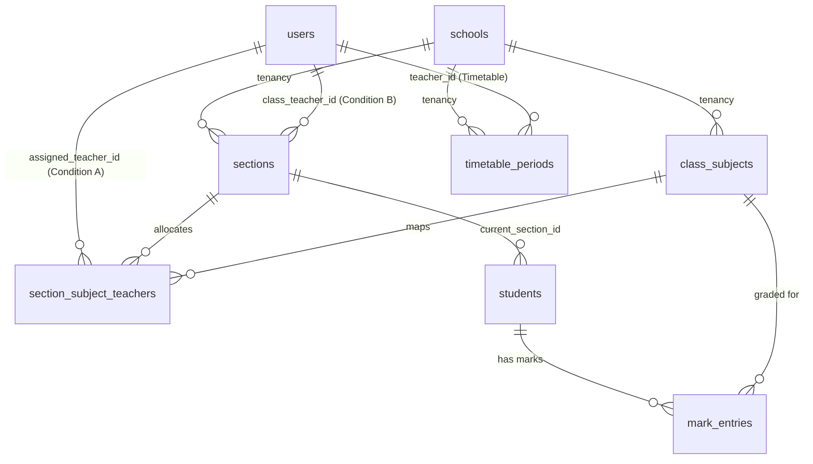
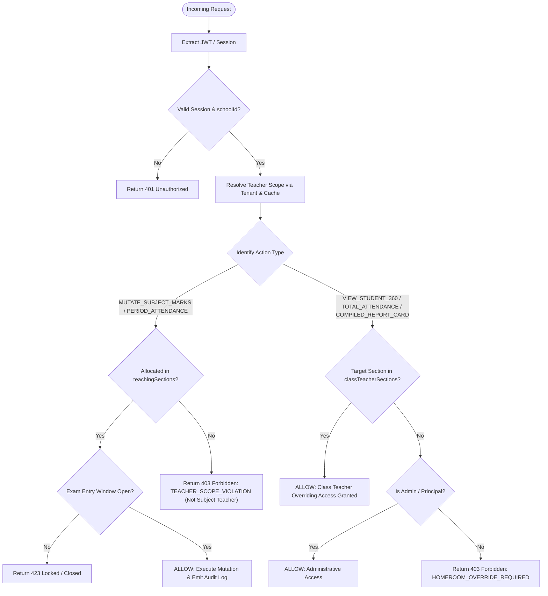

# Dual-Role Teacher Permission Architecture: Subject Teacher vs. Class Teacher (Homeroom)

## 1. Executive Summary & Problem Formulation

In a modern Multi-Tenant K-12 School ERP, academic staffing operates under a **dual-role paradigm** where a single authenticated teacher holds two distinct authorization scopes within the same school tenant:

1. **Condition A — Subject Teacher Scope (Horizontal / Fine-Grained)**:
   - The teacher is allocated specific subjects and sections in the academic timetable (e.g., *Class 9-A Mathematics*, *Class 10-B Mathematics*).
   - **Boundary**: They can **ONLY** input, update, or view marks, homework grades, and period attendance for their assigned subject-section pairs.
   - **Enforcement**: Any attempt to read or modify marks or subject attendance outside their allocated subject-section mappings must immediately fail-closed and return an **HTTP 403 Forbidden** error.

2. **Condition B — Class Teacher / Homeroom Scope (Vertical / Holistic Override)**:
   - The teacher is appointed as the designated Homeroom/Class Teacher for a specific section (e.g., *Class 9-A*).
   - **Boundary**: They possess an overriding read/write privilege over **ALL** students enrolled in that homeroom, transcending subject boundaries.
   - **Privileges**:
     - Viewing the entire **Student 360 Profile** (academic trajectory, attendance records, health/pastoral notes, disciplinary logs, and encrypted PII).
     - Accessing holistic **Total Attendance Sheets** (day-wise roll-call records, aggregated percentage analytics, and student leave approvals).
     - Viewing and reviewing **Compiled Report Cards** featuring marks across **ALL** subjects taught by other subject teachers, and authoring authoritative homeroom remarks/conduct ratings.

---

## 2. JWT Token Payload vs. Session State Architecture

A fundamental architectural pitfall in multi-tenant SaaS is attempting to pack dynamic permission graphs (such as timetable allocations and section IDs) directly into the JWT token payload.

### 2.1 The Anti-Pattern: Bloated & Stale JWTs
```json
// ❌ ANTI-PATTERN: DO NOT STORE MAPPINGS IN JWT PAYLOAD
{
  "sub": "usr_998811",
  "schoolId": "sch_sparkids_01",
  "role": "TEACHER",
  "classTeacherOf": ["sec_9a"],
  "teachingAllocations": [
    { "sectionId": "sec_9a", "subjectId": "sub_math" },
    { "sectionId": "sec_9b", "subjectId": "sub_math" },
    { "sectionId": "sec_10a", "subjectId": "sub_physics" }
  ]
}
```
**Why this breaks in production**:
1. **Header Size Exceeded (> 4KB)**: Teachers with multiple grade sections, elective clusters, and timetable periods cause cookie/header overflow.
2. **Stale Authorization Vulnerability**: Timetable swaps, teacher substitutions, or mid-year class-teacher reassignments leave the client with outdated claims until token expiry, causing unauthorized mutations or false 403s.
3. **Multi-Tenant Leakage Risk**: Tokens cannot dynamically adjust when administrative delegations occur without full re-authentication.

---

### 2.2 The Recommended Standard: Lean JWT + Dynamic Scope Cache

Keep the JWT token lean, immutable, and tenant-pinned. Dynamic authorization mappings are evaluated at runtime by a **Teacher Scope Engine** backed by a short-lived cache (Redis or in-process memory) with instantaneous event-driven invalidation.

#### 1. Minimal JWT / Session Token Payload
The JWT carries only identity, tenant tenancy, base role, and an authorization version nonce:

```json
{
  "sub": "usr_998811",
  "email": "sunita.sharma@sparkids.edu",
  "schoolId": "sch_sparkids_01",
  "tenantSlug": "sparkids",
  "role": "TEACHER",
  "academicYearId": "ay_2026_2027",
  "authVersion": 3,
  "iat": 1774348800,
  "exp": 1774392000
}
```

| Claim | Type | Description |
| :--- | :--- | :--- |
| `sub` | `UUID / String` | Unique User ID of the staff member (`users.id`). |
| `schoolId` | `UUID / String` | Tenant discriminator (`schools.id`). Mandatory for tenant isolation. |
| `tenantSlug` | `String` | Subdomain key (e.g. `sparkids.schoolmitra.in`). |
| `role` | `String` | High-level system role (`TEACHER`). |
| `academicYearId` | `UUID / String` | Currently active academic year context. |
| `authVersion` | `Integer` | Nonce bumped whenever staff role or timetable re-allocation occurs. |

#### 2. Resolved Session State (Resolved Server-Side in Cache / Memory)
```typescript
export interface TeacherResolvedScope {
  teacherUserId: string;
  schoolId: string;
  academicYearId: string;
  // Condition B: Sections where this teacher is the designated Class Teacher
  classTeacherSections: string[]; // e.g. ["sec_9a"]
  // Condition A: Subject-to-section allocations from timetable & master mapping
  teachingSections: Array<{
    sectionId: string;
    classSubjectId: string;
    subjectId: string;
  }>; // e.g. [{ sectionId: "sec_9a", classSubjectId: "cs_math_9a", subjectId: "sub_math" }, ...]
  // Union of all section IDs accessible in any capacity
  allAuthorizedSectionIds: string[];
}
```

- **Cache Lifetime**: Cached in Redis under `teacher_scope:{schoolId}:{teacherUserId}:{academicYearId}` with a **TTL of 300 seconds** (or request-scoped memory cache in serverless functions).
- **Invalidation Triggers**: Subscribed to Domain Events (`TIMETABLE_ALLOCATION_UPDATED`, `SECTION_CLASS_TEACHER_REASSIGNED`, `TEACHER_SUBSTITUTION_CONFIRMED`).

---

## 3. Relational Schema Blueprint (PostgreSQL / Drizzle)

The underlying schema ties tenant isolation (`school_id`), class-teacher homeroom designation, and subject-section timetable mappings together:



### Key Relational Anchors:
1. **Class Teacher Relationship**: `sections.class_teacher_id = users.id`
2. **Subject Allocation Relationship**:
   - `section_subject_teachers` (direct override for section + subject)
   - `class_subjects.assigned_teacher_id` (grade-wide fallback)
   - `timetable_periods.teacher_id` (scheduled routine slot)
3. **Student Enrollment**: `students.current_section_id = sections.id`

---

## 4. Permission Decision Matrix

| Resource & Operation | Target Scope | Condition A: Subject Teacher | Condition B: Class Teacher | Rule Enforcement & Outcome |
| :--- | :--- | :--- | :--- | :--- |
| **Input / Update Subject Marks** | Own Subject + Own Section | **PERMITTED** | **PERMITTED** *(if also Subject Teacher)* | `ALLOW (200)` |
| **Input / Update Subject Marks** | Other Subject OR Other Section | **DENIED** | **DENIED** *(Class Teacher cannot forge other teachers' subject marks)* | **`403 FORBIDDEN`** *(Anti-Tamper Invariant)* |
| **View Subject Marks Sheet** | Own Subject + Own Section | **PERMITTED** | **PERMITTED** | `ALLOW (200)` |
| **View Subject Marks Sheet** | Different Subject in Own Homeroom | **DENIED** | **PERMITTED** *(Homeroom inspection rights)* | `Class Teacher Override -> ALLOW (200)` |
| **View Student 360 Profile** | Student in Own Homeroom | Read restricted to subject | **FULL ACCESS** *(Academic, attendance, notes)* | `Class Teacher Override -> ALLOW (200)` |
| **View Student 360 Profile** | Student in Different Section | **DENIED** | **DENIED** | **`403 FORBIDDEN`** |
| **Total Section Attendance Sheet** | Own Homeroom Section | Read only for own period | **FULL ACCESS** *(Morning roll-call & totals)* | `Class Teacher Override -> ALLOW (200)` |
| **Compiled Report Card** | Students in Own Homeroom | Can view own subject mark only | **FULL COMPILED CARD + REMARKS** | `Class Teacher Override -> ALLOW (200)` |

---

## 5. Formal Permission Check Algorithm



---

## 6. Production Implementation (TypeScript / Middleware & Engine)

### 6.1 Teacher Scope Resolver (`scopeResolver.ts`)

```typescript
import { db } from "@/db";
import {
  sections,
  sectionSubjectTeachers,
  classSubjects,
  timetablePeriods,
  academicYears,
} from "@/db/schema";
import { eq, and, or, isNull, gte } from "drizzle-orm";

export class TeacherScopeError extends Error {
  public readonly statusCode: number = 403;
  public readonly code: string;

  constructor(message: string, code: string = "TEACHER_SCOPE_VIOLATION") {
    super(message);
    this.name = "TeacherScopeError";
    this.code = code;
    this.statusCode = 403;
  }
}

export interface TeachingSectionAllocation {
  sectionId: string;
  classSubjectId: string;
  subjectId: string;
}

export interface TeacherScope {
  teacherUserId: string;
  schoolId: string;
  academicYearId: string;
  classTeacherSections: string[];
  teachingSections: TeachingSectionAllocation[];
  allSectionIds: string[];
}

/**
 * Resolves the teacher's dual permissions inside the tenant boundary.
 * Highly optimized with Redis/In-Memory Cache (TTL: 5-60s).
 */
export async function resolveTeacherScope(
  teacherUserId: string,
  schoolId: string,
  academicYearId: string,
  tx: any = db
): Promise<TeacherScope> {
  // 1. Fetch sections where the user is designated CLASS TEACHER (Condition B)
  const homeroomRows = await tx.query.sections.findMany({
    where: and(
      eq(sections.schoolId, schoolId),
      eq(sections.classTeacherId, teacherUserId),
      eq(sections.isActive, true)
    ),
    columns: { id: true },
  });
  const classTeacherSections = homeroomRows.map((r: { id: string }) => r.id);

  // 2. Fetch SUBJECT TEACHER allocations via section overrides (Condition A)
  const todayStr = new Date().toISOString().split("T")[0];
  const sectionSubjectRows = await tx.query.sectionSubjectTeachers.findMany({
    where: and(
      eq(sectionSubjectTeachers.schoolId, schoolId),
      eq(sectionSubjectTeachers.teacherId, teacherUserId),
      eq(sectionSubjectTeachers.isActive, true),
      or(
        isNull(sectionSubjectTeachers.effectiveTo),
        gte(sectionSubjectTeachers.effectiveTo, todayStr)
      )
    ),
    with: {
      classSubject: {
        columns: { id: true, subjectId: true },
      },
    },
  });

  // 3. Fetch grade-wide subject assignments fallback
  const classSubjectDefaultRows = await tx.query.classSubjects.findMany({
    where: and(
      eq(classSubjects.schoolId, schoolId),
      eq(classSubjects.assignedTeacherId, teacherUserId)
    ),
    with: {
      class: {
        with: {
          sections: {
            where: eq(sections.isActive, true),
            columns: { id: true },
          },
        },
      },
    },
  });

  // Consolidate allocations
  const teachingSectionMap = new Map<string, TeachingSectionAllocation>();

  for (const sst of sectionSubjectRows) {
    if (sst.classSubject) {
      const key = `${sst.sectionId}:${sst.classSubject.subjectId}`;
      teachingSectionMap.set(key, {
        sectionId: sst.sectionId,
        classSubjectId: sst.classSubjectId,
        subjectId: sst.classSubject.subjectId,
      });
    }
  }

  for (const cs of classSubjectDefaultRows) {
    if (cs.class?.sections) {
      for (const sec of cs.class.sections) {
        const key = `${sec.id}:${cs.subjectId}`;
        if (!teachingSectionMap.has(key)) {
          teachingSectionMap.set(key, {
            sectionId: sec.id,
            classSubjectId: cs.id,
            subjectId: cs.subjectId,
          });
        }
      }
    }
  }

  const teachingSections = Array.from(teachingSectionMap.values());
  const allSectionIds = Array.from(
    new Set([
      ...classTeacherSections,
      ...teachingSections.map((ts) => ts.sectionId),
    ])
  );

  return {
    teacherUserId,
    schoolId,
    academicYearId,
    classTeacherSections,
    teachingSections,
    allSectionIds,
  };
}
```

---

### 6.2 The Dual-Role Guard Logic (`teacherAuthGuards.ts`)

```typescript
import { resolveTeacherScope, TeacherScopeError, TeacherScope } from "./scopeResolver";
import { students } from "@/db/schema";
import { eq, and } from "drizzle-orm";

export interface RequestAuthContext {
  userId: string;
  schoolId: string;
  role: string;
  academicYearId: string;
}

/**
 * CONDITION A: Asserts that the teacher is the authorized Subject Teacher
 * for the given section and subject/classSubject.
 * Class Teacher status DOES NOT permit forging marks for other subjects.
 */
export async function assertSubjectTeacherPermission(
  ctx: RequestAuthContext,
  targetSectionId: string,
  targetClassSubjectId: string,
  tx: any
): Promise<TeacherScope> {
  const scope = await resolveTeacherScope(ctx.userId, ctx.schoolId, ctx.academicYearId, tx);

  const isAllocated = scope.teachingSections.some(
    (allocation) =>
      allocation.sectionId === targetSectionId &&
      allocation.classSubjectId === targetClassSubjectId
  );

  if (!isAllocated) {
    throw new TeacherScopeError(
      `Forbidden: Teacher ${ctx.userId} is not assigned to teach subject ${targetClassSubjectId} in section ${targetSectionId}.`,
      "SUBJECT_TEACHER_FORBIDDEN"
    );
  }

  return scope;
}

/**
 * CONDITION B: Asserts that the teacher is the designated Class Teacher (Homeroom)
 * for the requested student's section, or for the target section overall.
 * Unlocks Student 360, compiled report card, and holistic attendance sheet.
 */
export async function assertClassTeacherOverride(
  ctx: RequestAuthContext,
  targetSectionId: string,
  tx: any
): Promise<TeacherScope> {
  const scope = await resolveTeacherScope(ctx.userId, ctx.schoolId, ctx.academicYearId, tx);

  const isClassTeacher = scope.classTeacherSections.includes(targetSectionId);

  if (!isClassTeacher) {
    throw new TeacherScopeError(
      `Forbidden: Teacher ${ctx.userId} is not the designated Class Teacher for section ${targetSectionId}.`,
      "CLASS_TEACHER_OVERRIDE_REQUIRED"
    );
  }

  return scope;
}

/**
 * CONDITION B (Student 360 Profile Guard):
 * Resolves student's active section and asserts Homeroom Class Teacher authority.
 */
export async function assertStudent360Access(
  ctx: RequestAuthContext,
  studentId: string,
  tx: any
): Promise<{ scope: TeacherScope; student: any }> {
  // 1. Fetch student in current tenant
  const student = await tx.query.students.findFirst({
    where: and(
      eq(students.id, studentId),
      eq(students.schoolId, ctx.schoolId),
      eq(students.isActive, true)
    ),
  });

  if (!student) {
    throw new TeacherScopeError(`Student not found or inactive.`, "STUDENT_NOT_FOUND");
  }

  if (!student.currentSectionId) {
    throw new TeacherScopeError(`Student has no active section enrollment.`, "SECTION_NOT_ENROLLED");
  }

  // 2. Enforce Condition B
  const scope = await assertClassTeacherOverride(ctx, student.currentSectionId, tx);

  return { scope, student };
}
```

---

### 6.3 API Route / Server Action Handler Implementation

#### Handler 1: Update Subject Marks (Condition A Enforced)
```typescript
import { assertSubjectTeacherPermission } from "./teacherAuthGuards";
import { withTenant } from "@/lib/tenant";

export async function updateMarksAction(input: {
  sectionId: string;
  classSubjectId: string;
  examId: string;
  markEntries: Array<{ studentId: string; marksObtained: number; isAbsent: boolean }>;
}) {
  const session = await getAuthenticatedTeacherSession(); // Extracts JWT context

  return await withTenant(session.schoolId, async (tx) => {
    // 🛡️ Enforce Condition A: Must be allocated Subject Teacher
    // Throws 403 TEACHER_SCOPE_FORBIDDEN if unauthorized
    await assertSubjectTeacherPermission(
      session,
      input.sectionId,
      input.classSubjectId,
      tx
    );

    // Verify marks lock window is currently open (anti-backdating)
    const isWindowOpen = await checkExamWindowStatus(input.examId, tx);
    if (!isWindowOpen) {
      throw new Error("MARKS_ENTRY_WINDOW_LOCKED");
    }

    // Perform atomic batch upsert of marks
    await tx.insert(markEntries)
      .values(
        input.markEntries.map((m) => ({
          schoolId: session.schoolId,
          examId: input.examId,
          studentId: m.studentId,
          classSubjectId: input.classSubjectId,
          marksObtained: m.marksObtained,
          isAbsent: m.isAbsent,
          gradedByTeacherId: session.userId,
          updatedAt: new Date(),
        }))
      )
      .onConflictDoUpdate({
        target: [markEntries.examId, markEntries.studentId, markEntries.classSubjectId],
        set: {
          marksObtained: sql`excluded.marks_obtained`,
          isAbsent: sql`excluded.is_absent`,
          gradedByTeacherId: session.userId,
          updatedAt: new Date(),
        },
      });

    return { success: true, count: input.markEntries.length };
  });
}
```

#### Handler 2: View Student 360 Profile (Condition B Overriding Access)
```typescript
import { assertStudent360Access } from "./teacherAuthGuards";
import { withTenant } from "@/lib/tenant";
import { decryptStudentPII } from "@/lib/encryption";

export async function getStudent360Profile(studentId: string) {
  const session = await getAuthenticatedTeacherSession();

  return await withTenant(session.schoolId, async (tx) => {
    // 🛡️ Enforce Condition B: Caller must be designated Class Teacher for student's section
    const { student } = await assertStudent360Access(session, studentId, tx);

    // Fetch comprehensive 360 profile
    const [attendanceSummary, allMarks, pastoralNotes, feeStatus] = await Promise.all([
      fetchAggregateAttendance(student.id, tx),
      fetchAllSubjectMarks(student.id, tx),       // Transcends all subjects
      fetchPastoralNotes(student.id, tx),          // Health, behavioral, family context
      fetchStudentFeeStatusBadge(student.id, tx),  // 'PAID' | 'DUE' | 'OVERDUE' (no amounts)
    ]);

    // Decrypt PII under legal authorization of Class Teacher
    const decryptedIdentity = decryptStudentPII(student);

    return {
      student: decryptedIdentity,
      attendance: attendanceSummary,
      academicTranscript: allMarks,
      pastoralNotes,
      feeStatusBadge: feeStatus,
    };
  });
}
```

#### Handler 3: View Compiled Report Cards (Condition B Overriding Access)
```typescript
import { assertClassTeacherOverride } from "./teacherAuthGuards";
import { withTenant } from "@/lib/tenant";

export async function getCompiledSectionReportCards(sectionId: string, examTermId: string) {
  const session = await getAuthenticatedTeacherSession();

  return await withTenant(session.schoolId, async (tx) => {
    // 🛡️ Enforce Condition B: Must be Class Teacher of this homeroom section
    await assertClassTeacherOverride(session, sectionId, tx);

    // Fetch compiled cross-subject grades for all students in homeroom
    const reportCards = await tx.query.compiledReportCards.findMany({
      where: and(
        eq(compiledReportCards.schoolId, session.schoolId),
        eq(compiledReportCards.sectionId, sectionId),
        eq(compiledReportCards.examTermId, examTermId)
      ),
      with: {
        student: true,
        subjectMarks: {
          with: { subject: true, teacher: { columns: { name: true } } },
        },
      },
    });

    return reportCards;
  });
}
```

---

## 7. Security & DPDP Compliance Invariants

1. **Strict Fail-Closed Row-Level Tenancy (`withTenant`)**:
   - Every database query executes with `SET LOCAL app.current_school_id = :schoolId`.
   - Cross-school data leakage is physically blocked at the database engine level via PostgreSQL RLS policies.

2. **Tamper Prevention on Marks Mutation**:
   - While a Class Teacher can **READ** all subject marks on a compiled report card for their homeroom students, they are **PROHIBITED** from updating or altering marks in subjects they do not teach. Only the allocated Subject Teacher or an authorized School Admin can mutate subject scores.

3. **Student Privacy & Commercial Decoupling**:
   - In compliance with student data privacy laws (e.g. DPDP Act 2023), teachers never receive raw ledger payment details, fee amounts, or parental bank information.
   - Teachers receive strictly a sanitized categorical badge (`PAID`, `DUE`, `OVERDUE`) on section rosters to avoid student stigmatization.

4. **Audit Trail Logging**:
   - Any invocation of a Class Teacher Override or 403 Scope Violation emits a structured audit record:
     ```json
     {
       "event": "TEACHER_SCOPE_EVALUATION",
       "teacherId": "usr_998811",
       "action": "MUTATE_SUBJECT_MARKS",
       "targetSectionId": "sec_10b",
       "targetSubjectId": "sub_chemistry",
       "outcome": "403_FORBIDDEN",
       "timestamp": "2026-10-24T10:55:00Z"
     }
     ```
