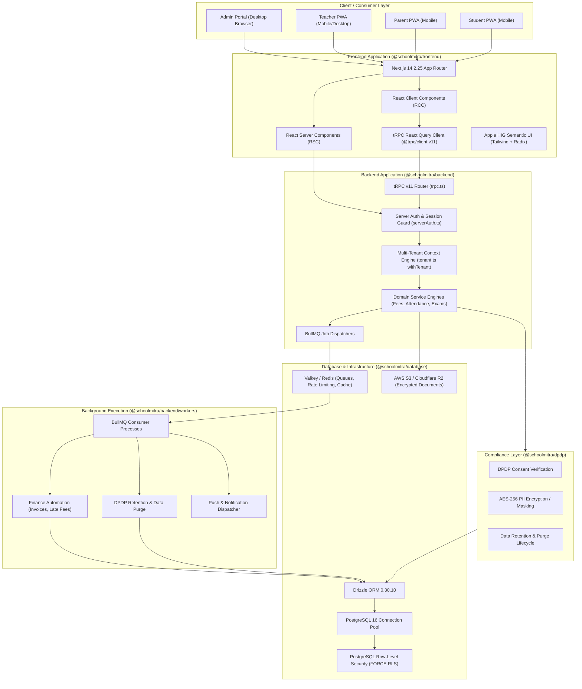

# SchoolMitra ERP — System Architecture Map (Phase 00)
**Directive**: `EDUCORE_MASTER_ENGINEERING_EXCELLENCE` v1.0.0  
**Audit Date**: November 25, 2026  
**Baseline Version**: `11.59.1`

---

## 1. Monorepo Structural Layers



---

## 2. Multi-Tenancy Resolution Lifecycle

Every request operates strictly under a single school tenant:
1. **Host Header Resolution**:
   - Subdomain mapping: `<slug>.schoolmitra.com` resolves `schools.slug`.
   - Local development: `<subdomain>.localhost:3002` resolves tenant.
   - Cloud deployment fallback (*.onrender.com, *.vercel.app): Tenant derived from authenticated session cookie.
2. **Session Context Injection**:
   - `serverAuth.ts` reads encrypted JWT session and extracts `user.schoolId` and `user.role`.
   - Impersonation: `SUPER_ADMIN` can assume tenant context via cryptographically signed `x-school-impersonation` cookie with mandatory reason audit logging.
3. **Database Tenant Isolation (`withTenant`)**:
   - Calls `db.transaction()` and executes:
     ```sql
     SET LOCAL app.current_school_id = '<school_uuid>';
     ```
   - PostgreSQL Row Level Security (RLS) inspects `current_setting('app.current_school_id', true)` to enforce row isolation.
   - **Architectural Invariant**: All operations inside `withTenant` MUST execute against the transaction client `tx`, never the unconfigured global pool `db`.

---

## 3. Data Protection & Privacy Architecture (DPDP Act 2023)
- **Zero-Storage for Student Phone/Email**: Minor students authenticate via `admissionNumber` + `dateOfBirth` with rate-limited claim sessions.
- **PII Obfuscation**: Aadhaar numbers masked to last 4 digits (`XXXX-XXXX-1234`).
- **Encrypted Field-Level Storage**: Government IDs and bank details encrypted with AES-256-GCM via `@schoolmitra/dpdp`.
- **Purpose-Specific Consents**: Academic, health, and transport processing require explicit verifiable parental consent before activation.

---

## 4. External Integrations Map

| Provider | Service / Protocol | Monorepo Usage | Security Controls |
| :--- | :--- | :--- | :--- |
| **Valkey / Redis** | Redis v7 / Valkey Protocol | Rate Limiter, BullMQ Queues, School Cache | TLS in transit, circuit breaker, bounded retry |
| **Razorpay** | REST API & Webhooks | Fee Collection, Online Payments | HMAC-SHA256 signature verification, idempotent ledger |
| **AWS S3 / R2** | S3 API (Signed URLs) | Student Documents, Staff KYC, Reports | SSE-KMS encryption, private buckets, presigned URLs (60s TTL) |
| **WebPush / VAPID** | RFC 8291 WebPush Protocol | PWA Real-Time Alerts | VAPID keypair authentication, rate-limited dispatch |
| **Nodemailer** | SMTP with STARTTLS | System Alerts, Staff Invoices | Async worker dispatch, no raw user transport options |
