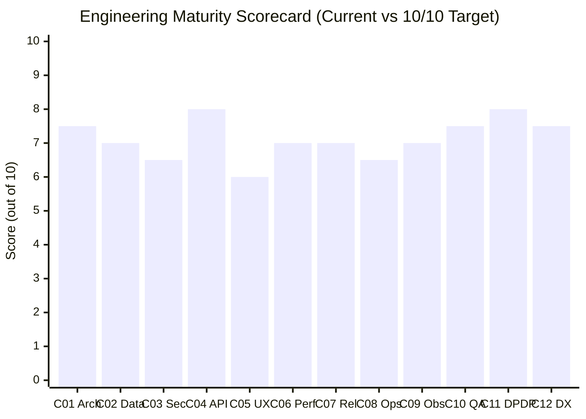

# SchoolMitra ERP — Baseline Scorecard (Phase 00)
**Directive**: `EDUCORE_MASTER_ENGINEERING_EXCELLENCE` v1.0.0  
**Audit Date**: November 25, 2026  
**Auditor Principle**: `Inspect_First_Design_Second_Implement_Third_Verify_Continuously`  
**Scoring Rule**: `No_Self_Certification_Without_Verifiable_Evidence`

---

## 1. Monorepo Maturity Summary Across 12 Categories

**Overall Monorepo Baseline Score: 7.12 / 10.00**

---

## 2. Category-by-Category Evidence-Backed Evaluation

### C01: System Architecture (Score: 7.5 / 10.0)
- **Strengths**: Clean Turborepo monorepo topology; strict DAG package hierarchy; clear layer separation (presentation, API, persistence, compliance).
- **Gaps / Weaknesses**: Inconsistent transaction client propagation in background BullMQ workers.
- **Verifiable Evidence**: `pnpm run type-check` passes across all 7 workspace packages. Workers instantiated without unified context lifecycle.

### C02: Data Architecture & Integrity (Score: 7.0 / 10.0)
- **Strengths**: 58 cleanly journaled PostgreSQL migrations; zero sequence collisions; Drizzle typed schemas across 19 modules.
- **Gaps / Weaknesses**: Background workers (`financeAutomation.ts`, `retention.ts`) execute writes against unconfigured global `db` instead of `tx`, circumventing tenant context boundaries.
- **Verifiable Evidence**: `backend/src/workers/financeAutomation.ts` line 41 (`db.update(feeInvoices)` without `tx`).

### C03: Multi-Tenancy & Security (Score: 6.5 / 10.0)
- **Strengths**: Subdomain resolution; fail-closed RLS enabled via migration 0041; DPDP consent checks in student admission.
- **Gaps / Weaknesses**:
  1. Super Admin session validation skips `users.isActive` checks (`serverAuth.ts` line 32).
  2. `.audit-exceptions.json` uses wildcard `advisoryId: "*"` masking critical CVEs.
  3. Production CSP includes `'unsafe-inline'` script policy without cryptographic nonces.
- **Verifiable Evidence**: `scripts/audit-dependencies.mjs` identifies 4 unapproved CVEs; `serverAuth.ts` line 32.

### C04: API Design & Contracts (Score: 8.0 / 10.0)
- **Strengths**: End-to-end typed tRPC v11 router; shared Zod validation contracts in `@schoolmitra/validators`; role-based procedure guards.
- **Gaps / Weaknesses**: Certain server actions lack centralized rate limiting and replay prevention.
- **Verifiable Evidence**: All tRPC routers strictly typed; passing TS check.

### C05: Frontend Architecture, UX & Accessibility (Score: 6.0 / 10.0)
- **Strengths**: Next.js 14 App Router; Radix UI headless primitives; responsive layout shells.
- **Gaps / Weaknesses**:
  1. 12,302 color escapes across 340 files (`scripts/audit-color-tokens.mjs`), with raw `slate`, `emerald`, `amber`, and hex values.
  2. Sub-modules across Admissions, Academics, Exams, Fees, Accounts, Transport, HR, DPDP, and Settings display inconsistent dark theme accents instead of Apple HIG semantic module scopes.
- **Verifiable Evidence**: `node scripts/audit-color-tokens.mjs` outputs 12,302 violations; screenshots from user prompt.

### C06: Performance & Scalability (Score: 7.0 / 10.0)
- **Strengths**: Route bundle size budgets enforced in CI (`check-bundle-budgets.mjs`); React Server Components for zero-bundle data views.
- **Gaps / Weaknesses**: In-memory rate limiting fallback stores uncoordinated state in per-process Map on Redis drop; potential memory leak if uncleaned.
- **Verifiable Evidence**: `backend/src/lib/rateLimiter.ts` line 78 (`const memoryRateLimitMap = new Map()`).

### C07: Reliability & Fault Tolerance (Score: 7.0 / 10.0)
- **Strengths**: Circuit breaker pattern on Redis/Valkey (`recordRedisFailure`); fail-closed session auth.
- **Gaps / Weaknesses**: BullMQ jobs lack idempotent transaction envelopes and dead-letter queue (DLQ) automated replay.
- **Verifiable Evidence**: Worker retry strategies in `financeAutomation.ts`.

### C08: Infrastructure & DevSecOps (Score: 6.5 / 10.0)
- **Strengths**: GitHub Actions CI with Postgres & Redis service containers; migration journal verification; bundle analysis.
- **Gaps / Weaknesses**: CI only runs `lint` on `frontend` (`pnpm --filter @schoolmitra/frontend run lint`), leaving backend and all shared packages unlinted.
- **Verifiable Evidence**: `.github/workflows/ci.yml` line 100.

### C09: Observability & Monitoring (Score: 7.0 / 10.0)
- **Strengths**: Structured logging with Pino (`pino-pretty`); AWS CloudWatch client integration; worker heartbeat tracking.
- **Gaps / Weaknesses**: Lack of distributed trace context (W3C TraceContext) across tRPC requests and BullMQ background jobs.
- **Verifiable Evidence**: `workerHeartbeats` schema in database; Pino logger in backend.

### C10: Testing & Quality Engineering (Score: 7.5 / 10.0)
- **Strengths**: Vitest unit test suites; Playwright E2E browser tests with non-owner security identity; migration safety checks.
- **Gaps / Weaknesses**: Negative tests for worker tenant boundary leakage and rate limiter circuit tripping are missing.
- **Verifiable Evidence**: Test scripts configured in root and packages.

### C11: Compliance, Privacy & Governance (Score: 8.0 / 10.0)
- **Strengths**: Dedicated `@schoolmitra/dpdp` package; parental consent verification; PII masking; audit trails for all data reads.
- **Gaps / Weaknesses**: Retention purge cron job executes unscoped raw queries.
- **Verifiable Evidence**: `packages/dpdp/` implementation and tests.

### C12: Maintainability, Documentation & DX (Score: 7.5 / 10.0)
- **Strengths**: Rich product charter (`product-destination-charter.json`); comprehensive spec documents; Turborepo caching.
- **Gaps / Weaknesses**: Absence of formal ADR directory (`docs/engineering/adr/`) and centralized architecture documentation.
- **Verifiable Evidence**: `docs/` specifications and root README.

---

## 3. Path to 10/10 Maturity Target

| Category | Current | Target | Critical Remediation Focus |
| :--- | :---: | :---: | :--- |
| **C01 System Architecture** | 7.5 | **10.0** | Unified worker transaction context propagation & architectural invariants. |
| **C02 Data Integrity** | 7.0 | **10.0** | Mandatory `tx` parameter in all worker operations; complete RLS verification. |
| **C03 Multi-Tenancy & Sec** | 6.5 | **10.0** | Fix Super Admin active check; eliminate wildcard CVE exceptions; strict CSP nonces. |
| **C04 API Design** | 8.0 | **10.0** | Replay-protected server actions; idempotent mutation tokens. |
| **C05 Frontend & Apple HIG** | 6.0 | **10.0** | Eliminate 12,302 color escapes; implement module-scoped Apple HIG tokens. |
| **C06 Performance** | 7.0 | **10.0** | Hardened distributed rate limiting with bounded memory failover. |
| **C07 Reliability** | 7.0 | **10.0** | Idempotency keys on all BullMQ financial operations; structured DLQ alerts. |
| **C08 DevSecOps** | 6.5 | **10.0** | Monorepo CI linting across all packages; strict automated audit gate. |
| **C09 Observability** | 7.0 | **10.0** | Unified correlation IDs linking tRPC requests to worker executions. |
| **C10 Testing & QA** | 7.5 | **10.0** | Automated multi-tenant leakage regression test suite. |
| **C11 Compliance & DPDP** | 8.0 | **10.0** | Hardened retention purge transactions; automated consent revocation triggers. |
| **C12 Maintainability & DX** | 7.5 | **10.0** | Land formal Architecture Decision Records (ADRs) and engineering roadmap. |
