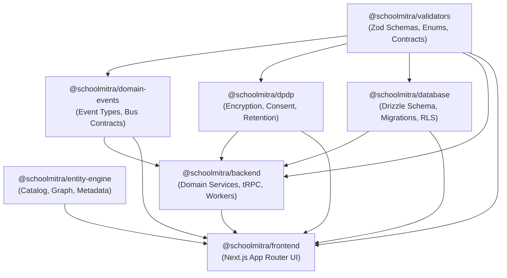

# SchoolMitra ERP — Dependency Map & Security Analysis (Phase 00)
**Directive**: `EDUCORE_MASTER_ENGINEERING_EXCELLENCE` v1.0.0  
**Audit Date**: November 25, 2026  
**Package Manager**: `pnpm` 9.7.0  
**Node Engine**: `>=20.0.0`

---

## 1. Monorepo Internal Dependency Graph

The workspace strictly follows a directed acyclic graph (DAG). Cyclic dependencies between packages are forbidden and enforced via `pnpm` workspace filters and TypeScript project references.

### Dependency Rules & Boundaries:
1. `@schoolmitra/validators` has **zero workspace dependencies**. It is a pure leaf package containing runtime Zod types.
2. `@schoolmitra/database` exports schemas and migration runners; it never imports from `@schoolmitra/backend` or `@schoolmitra/frontend`.
3. `@schoolmitra/backend` exports domain calculation engines, tRPC routers, and worker handlers.
4. `@schoolmitra/frontend` consumes `@schoolmitra/backend` via tRPC type contracts and React Server Actions.

---

## 2. External Dependencies & Version Risk Analysis

| Package Category | Core Libraries | Version | Risk Assessment | Mitigation |
| :--- | :--- | :--- | :--- | :--- |
| **Framework** | `next` | `14.2.25` | Medium (Server actions / RSC attack surface) | Strict reverse proxy rate limiting, fail-closed auth, Cloudflare edge filters. |
| **Database ORM** | `drizzle-orm` / `pg` | `0.30.10` / `8.11.5` | Low (Raw SQL identifier escape CVEs) | All queries utilize typed Drizzle schema builders or parameterized `sql` tags. |
| **Auth** | `next-auth` | `5.0.0-beta.16` | High (Beta release, session bypass risks) | Custom fail-closed `serverAuth.ts` with explicit DB user active & role verification. |
| **Async Queues** | `bullmq` / `ioredis` | `5.4.2` / `5.3.2` | Low (Redis connection drop risks) | Redis circuit breaker (`recordRedisFailure`), 30s backoff cooldown. |
| **Validation** | `zod` | `3.25.76` | Medium (GHSA-mrhx-c7xc-m3w5 ReDoS on oversized arrays) | Input length limits on JSON payloads in middleware before Zod parse. |
| **Security / Crypto** | `jose` / `bcryptjs` | `5.2.3` / `2.4.3` | Low (Cryptographic primitives) | Industry-standard JWT & bcrypt implementations; constant-time comparisons. |
| **Styling / Tokens** | `tailwindcss` | `3.4.3` | High (12,302 color escapes in 340 files) | Module-scoped Apple HIG semantic tokens replacing hardcoded Tailwind colors. |

---

## 3. Package Manager Security Audit Baseline (`pnpm audit`)

Execution of `node scripts/audit-dependencies.mjs` against live registry:
- **Total Reported Advisories**: `180`
- **High / Critical Severity Advisories**: `74`
- **Approved via `.audit-exceptions.json`**: `70`
- **Unapproved Violations Detected**: `4`

### Active Unapproved Security Findings:
1. `follow-redirects` (`GHSA-q3jh-wrc6-jgq8`, High): Array-form headers bypass cross-origin credential stripping. Recommended: Upgrade to `>=1.16.1`.
2. `follow-redirects` (`GHSA-8r9p-f939-6h3c`, High): SensitiveHeaders regex escaping credential exposure. Recommended: Upgrade to `>=1.16.1`.
3. `follow-redirects` (`GHSA-mrwp-f3q8-3g9p`, High): Cross-realm sensitiveHeaders arrays discarded. Recommended: Upgrade to `>=1.16.2`.
4. `zod` (`GHSA-mrhx-c7xc-m3w5`, High): Memory exhaustion during oversized constrained collection validation. Recommended: Constrain payload boundaries or upgrade to patch.

### Flaw in Audit Governance (`.audit-exceptions.json`):
- Several packages (`glob`, `next`, `minimatch`, `drizzle-orm`, `nodemailer`, `vite`, `fast-uri`, `postcss`, `brace-expansion`, `undici`, `js-yaml`, `next-auth`) have `advisoryId: "*"`.
- **Architectural Risk**: Any newly discovered 0-day or critical CVE in these packages will silently pass CI.
- **Remediation**: Transition to an **exact CVE-ID whitelisting policy** with mandatory expiration dates and rationale.
