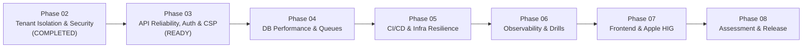

# SchoolMitra ERP — Remediation Roadmap (Phase 02 Continuation)

**Directive ID:** `EDUCORE_ENGINEERING_EXCELLENCE_PHASE02_CONTINUATION`  
**Version:** 1.1.0  
**Target Maturity:** Evidence-Backed 10.00 / 10.00 Across All 11 Engineering Domains  
**Execution Principle:** Phased, Non-Breaking, Automated Verification at Every Gate  
**Scoring Principle:** `No_Self_Certification_Without_Verifiable_Evidence`  

---

## 1. Phased Remediation Overview

---

## 2. Phase-by-Phase Execution Architecture

### Phase 02: Tenant Isolation, Financial Integrity, Critical Security & CI Baseline (COMPLETED)
- **Goal:** Resolve all architectural defects threatening data integrity, multi-tenancy, and security compliance; fix blocking CI lint errors.
- **Key Landed Deliverables:**
  1. Mandatory `tx: TenantTransaction` in all background worker call chains (`financeAutomation.ts`, `retention.ts`, `dpdp/actions.ts`).
  2. Live database active status and role verification for `SUPER_ADMIN` in platform context (`serverAuth.ts`).
  3. Migration `0059_complete_fail_closed_rls.sql` covering 136 gap tables (local/CI test verified); 9 runtime catalog tests passing.
  4. Elimination of all 20 wildcard exceptions in `.audit-exceptions.json` (67 exact GHSA IDs, 90-day expiry, fail-closed gate).
  5. Root-cause fix for 4 React Hook violations across `HRDashboardClient.tsx`, `SiblingPaymentCard.tsx`, `SyllabusDetailModal.tsx` (`next lint` exits code 0 with 0 errors).
  6. Established 11-domain `ENGINEERING_EXCELLENCE_CHECKLIST.md` and `ENGINEERING_CONTROL_COVERAGE.md`.

---

### Phase 03: API Reliability, Authentication, Session Security, Rate Limiting & CSP (READY)
- **Goal:** Protect public endpoints against brute force, connection drops, and XSS injection.
- **Tasks:**
  1. **SPEC-004 (Rate Limiting):** Implement bounded LRU rate limiter fallback in `backend/src/lib/rateLimiter.ts`; fail-closed policy on sensitive credentials and student claim flows during Redis partition.
  2. **SPEC-006 (Content Security Policy):** Generate dynamic per-request cryptographic nonces in Next.js middleware; remove `'unsafe-inline'` from production headers in `frontend/next.config.mjs`.
  3. **SPEC-008 (Session Security):** Enforce strict session token refresh ladders, 2FA challenge support for Super Admin, and brute-force lockout counters.
- **Gate Verification:**
  - Automated penetration test verifying rate limiter prevents brute-force attempts during simulated Redis outage.
  - Browser inspection verifying CSP response headers contain dynamic cryptographic nonce without `'unsafe-inline'`.

---

### Phase 04: Database Performance, Concurrency, Caching & Background-Job Reliability
- **Goal:** High-throughput transactional stability under peak morning intake and fee cycles.
- **Tasks:**
  1. Systematic index tuning and EXPLAIN query plan optimization across top 20 OLTP query paths.
  2. BullMQ graceful shutdown signal handling (`SIGTERM`/`SIGINT`) with queue intake pause and active job drainage.
  3. Connection pooling tuning and statement timeout budget enforcement.
  4. Monorepo package lint script coverage: add ESLint configurations and `lint` scripts to `backend`, `database`, `packages/dpdp`, `packages/entity-engine`, `packages/domain-events`, and `packages/eslint-plugin-schoolmitra`.
- **Gate Verification:**
  - `pnpm run lint` across entire workspace via Turborepo passes with zero errors on all 8 packages.
  - Zero unindexed table scans on tables with >1,000 records.

---

### Phase 05: CI/CD, Deployment Architecture, Infrastructure Security & Operational Resilience
- **Goal:** Automated, reproducible infrastructure and deployment pipelines with zero configuration drift.
- **Tasks:**
  1. Multi-stage Docker container hardening (non-root distroless execution, minimal attack surface).
  2. Infrastructure as Code (IaC) definitions for cloud S3, Neon, and Redis provisioning.
  3. GitHub Actions CI pipeline hardening: automated dependency scanning, migration checks, and branch protections.
  4. Staging environment parity automation.
- **Gate Verification:**
  - Docker container security scan reports zero high/critical vulnerabilities.
  - Automated deployment pipeline deploys to staging and runs automated smoke verification.

---

### Phase 06: Observability, Backups, Disaster Recovery, Performance/Load Tests & Comprehensive Regression Testing
- **Goal:** Complete operational visibility and proven recovery capability.
- **Tasks:**
  1. Distributed tracing: propagate `X-Correlation-ID` from HTTP ingress into BullMQ background job payloads.
  2. Disaster recovery drill: execute simulated point-in-time recovery (PITR) against disposable test database; verify RPO <1h, RTO <4h.
  3. Centralized metrics & alerting on database pool usage, worker queue lag, and error rates.
  4. High-concurrency load testing (simulating 2,000 concurrent students and fee collections).
- **Gate Verification:**
  - Documented disaster recovery drill report with verifiable restoration timestamps.
  - Distributed trace visualization demonstrating end-to-end correlation from click to worker completion.

---

### Phase 07: Frontend Accessibility, Responsive Quality, Approved Design-System Completion & Final Verification
- **Goal:** Transform administrative modules to ratified Apple HIG design system with zero accessibility barriers.
- **Tasks:**
  1. Systematic elimination of 12,302 color token escapes across all 10 core administrative modules (Admissions, Academics, Exams, Fee Matrix, Accounts/POS, Transport, Teacher 360, DPDP, Settings, Student 360).
  2. WCAG 2.2 AA accessibility audit (contrast ratios, screen reader ARIA labels, keyboard tab navigation).
  3. Resolution of the 19 informational ESLint warnings in administrative workbench components.
- **Gate Verification:**
  - `node scripts/audit-color-tokens.mjs` reports 0 violations across all 340 frontend files.
  - Automated axe-core accessibility audit reports zero violations.

---

### Phase 08: Independent Production-Readiness Assessment & Controlled Release
- **Goal:** Final evidence-backed verification of the product destination charter.
- **Tasks:**
  1. Comprehensive 11-domain scorecard evaluation with verifiable execution logs for every control.
  2. Final release tagging and staging verification.
  3. Controlled production cutover plan with zero downtime.
- **Gate Verification:**
  - Formal CTO sign-off on 10/10 maturity backed by test logs, audit reports, and live catalog queries.
