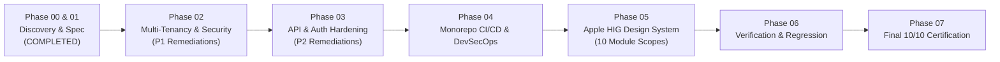

# SchoolMitra ERP — Remediation Roadmap (Phase 01)
**Directive**: `EDUCORE_MASTER_ENGINEERING_EXCELLENCE` v1.0.0  
**Target Maturity**: 10.00 / 10.00 Across All 12 Categories  
**Execution Principle**: Phased, Non-Breaking, Automated Verification at Every Gate

---

## 1. Phased Remediation Overview

---

## 2. Phase-by-Phase Execution Plan

### Phase 02: Multi-Tenancy, Data Integrity & Security Remediation (P1 Deliverables)
- **Goal**: Resolve all P1 architectural defects threatening data integrity, multi-tenancy, and security compliance.
- **Tasks**:
  1. **SPEC-001**: Refactor `backend/src/workers/financeAutomation.ts` and `retention.ts` to accept and propagate `tx` across all queries.
  2. **SPEC-002**: Clean `.audit-exceptions.json` to eliminate all wildcard `*` advisory IDs; replace with exact CVE IDs. Patch/pin `follow-redirects` and `zod`.
  3. **SPEC-003**: Execute exhaustive RLS verification script against all 19 database schema files and apply `FORCE ROW LEVEL SECURITY` where needed.
  4. **SPEC-005**: Update `backend/src/lib/serverAuth.ts` to enforce `users.isActive` check for `SUPER_ADMIN` in platform context.
- **Gate Verification**:
  - `node scripts/audit-dependencies.mjs` exits with code 0 (zero unapproved vulnerabilities).
  - Multi-tenant worker test suite confirms queries execute inside transaction context.
  - Deactivated Super Admin token test returns `null` session.

---

### Phase 03: API & Authentication Hardening (P2 Deliverables)
- **Goal**: Protect API endpoints against brute force, replay attacks, and connection drops.
- **Tasks**:
  1. **SPEC-004**: Implement bounded LRU rate limiter fallback in `backend/src/lib/rateLimiter.ts`; fail-closed policy on sensitive credentials/claims.
  2. **SPEC-006**: Generate dynamic CSP nonce in Next.js middleware and remove `'unsafe-inline'` from production headers in `frontend/next.config.mjs`.
- **Gate Verification**:
  - Penetration test verifying rate limiter prevents brute-force login attempts during simulated Redis outage.
  - Browser inspection verifying CSP response headers contain dynamic cryptographic nonce.

---

### Phase 04: Monorepo CI/CD & DevSecOps Hardening
- **Goal**: Eliminate static analysis blind spots and enforce monorepo-wide quality gates.
- **Tasks**:
  1. **SPEC-007**: Update `.github/workflows/ci.yml` to run `pnpm run lint` across all 8 workspace packages.
  2. Integrate `node scripts/audit-dependencies.mjs` into CI workflow before build step.
  3. Integrate `node scripts/audit-color-tokens.mjs` into pre-commit and CI gates.
- **Gate Verification**:
  - CI pipeline passes all jobs: monorepo lint, typecheck, migrations journal, unit tests, and security audits.

---

### Phase 05: Frontend Architecture & Module-Scoped Apple HIG Theming
- **Goal**: Eliminate 12,302 color escapes and transform all administrative screens to Apple HIG dark neutral styling with module-scoped semantic accents.
- **Sub-Modules in Scope**:
  1. **Admissions & Intake**: Apple Purple accent theme, 6-step wizard overhaul, DPDP notice styling.
  2. **Academics & Classes (ClassHub)**: Apple Blue accent theme, class cards, subject allocation matrix.
  3. **Exams & Evaluation**: Apple Indigo accent theme, 6-stage assessment pipeline, datesheets.
  4. **Fee Matrix**: Apple Emerald accent theme, class-wise fee pricing matrix, fine simulator.
  5. **Accounts Hub & Fee Collection**: Apple Green accent theme, POS counter terminal, 80mm thermal receipt preview.
  6. **Transport Operations**: Apple Amber accent theme, vehicle fleet desk, route stop manager.
  7. **HR & Staff (Teacher 360)**: Apple Cyan accent theme, photo avatar with monogram fallback, frequency tabs.
  8. **DPDP Compliance Centre**: Apple Teal accent theme, consent coverage gauges, purge center.
  9. **School Settings Dashboard**: Apple Zinc/Dark Neutral theme, setup progress cards.
  10. **Student 360 Profile**: High-stakes identity card, photo avatar upload path, truth-based metrics.
- **Gate Verification**:
  - `node scripts/audit-color-tokens.mjs` reports 0 violations across all 340 files.
  - Visual consistency across all 10 modules aligned with Apple Human Interface Guidelines.

---

### Phase 06: Verification & Automated Regression Testing
- **Goal**: Full automated verification across unit, integration, and E2E suites.
- **Tasks**:
  1. Run `pnpm --filter @schoolmitra/backend run test` (Vitest).
  2. Run `pnpm --filter @schoolmitra/frontend run test` (Vitest).
  3. Run `pnpm run type-check` across all 8 packages.
  4. Run `pnpm run lint` across the monorepo.
  5. Run Playwright E2E smoke tests.
- **Gate Verification**:
  - 100% test pass rate with zero failures.

---

### Phase 07: Final 10/10 Certification & Sign-off
- **Goal**: Re-score all 12 categories in `docs/engineering/BASELINE_SCORECARD.md` with verifiable proof and publish the Final Engineering Excellence Audit Report.
- **Gate Verification**:
  - All 12 categories achieve a verified score of 10.0 / 10.0.
  - Final report signed off and pushed to `main`.
