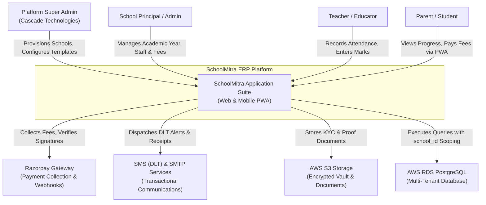
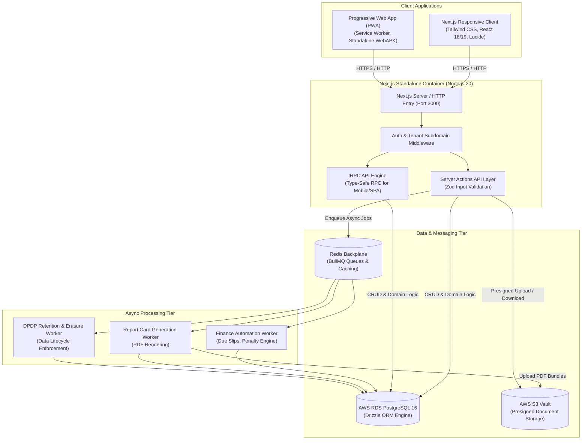
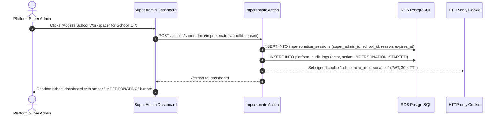
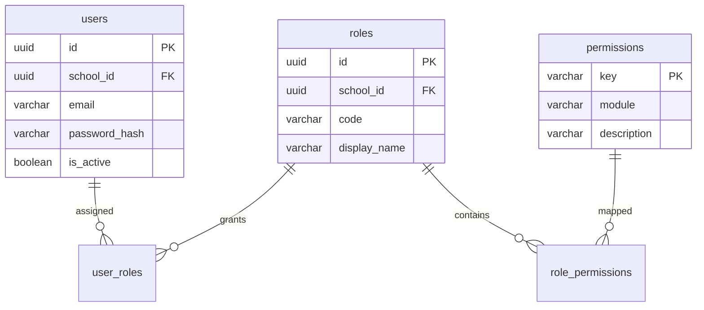

# SchoolMitra ERP — System Architecture & Design Patterns Manual

> **Document Classification**: Engineering Architecture Manual  
> **Target Audience**: System Architects, Lead Engineers, Backend Developers, Security Officers  
> **Status**: Production Reference  
> **Version**: 2.0.0  
> **Last Updated**: October 2026

---

## 1. Architectural Philosophy & Principles

SchoolMitra ERP is architected around four core design pillars:
1. **Zero-Trust Multi-Tenancy**: Complete logical separation of school institutional data at every layer of the stack (database, application memory, object storage, and audit logs).
2. **Event-Driven Resilience**: Decoupling time-critical user requests from resource-heavy background workloads (fee receipt generation, mass report card rendering, retention purges).
3. **Stateless Scale-Out**: Container instances retain zero in-memory session state; sessions and locks are anchored in encrypted JWTs and distributed Redis backplanes.
4. **Regulatory Privacy by Design**: Direct compliance with the **Digital Personal Data Protection (DPDP) Act 2023** embedded into the data model with immutable audit trails, purpose-bound consent graphs, and field-level AES-256 encryption.

---

## 2. C4 Architecture Model

### 2.1 System Context (Level 1)



### 2.2 Container Architecture (Level 2)



---

## 3. Multi-Tenant Isolation Strategy

SchoolMitra implements a **Row-Level Discriminator Multi-Tenant Architecture** enhanced by dynamic tenant context injection and isolated schema support.

### 3.1 Tenant Scoping Invariant (`school_id`)
Every operational table across the database (except `super_admin_users` and platform-wide templates) enforces a non-nullable `school_id` foreign key:

```typescript
// database/src/schema/academics.ts
export const classes = pgTable("classes", {
  id: uuid("id").defaultRandom().primaryKey(),
  schoolId: uuid("school_id")
    .notNull()
    .references(() => schools.id, { onDelete: "cascade" }),
  name: varchar("name", { length: 50 }).notNull(),
  gradeLevel: integer("grade_level").notNull(),
  capacity: integer("capacity").default(40),
  createdAt: timestamp("created_at", { withTimezone: true }).defaultNow().notNull(),
  updatedAt: timestamp("updated_at", { withTimezone: true }).defaultNow().notNull(),
}, (table) => ({
  schoolIdx: index("classes_school_id_idx").on(table.schoolId),
  uniqueNamePerSchool: uniqueIndex("classes_school_name_idx").on(table.schoolId, table.name),
}));
```

### 3.2 Subdomain & Routing Resolution
Incoming HTTP requests pass through `frontend/src/middleware.ts` which inspects the host header:
1. **Platform Root / Super Admin**: `app.schoolmitra.in` or `educore-alb-*.elb.amazonaws.com` routes to the Platform Hub or Super Admin Workspace (`/super-admin`).
2. **School Dedicated Subdomain**: `sparkids.schoolmitra.in` extracts the slug `sparkids`, resolves `schools.id`, and pins the tenant identifier in `request.headers` as `x-tenant-id` and `x-tenant-slug`.
3. **Session-Level Validation**: NextAuth verifies that the authenticated user's `session.user.schoolId` strictly matches the active tenant subdomain, preventing cross-tenant URL manipulation.

### 3.3 Platform Super Admin Impersonation Sessions
To enable platform support staff to diagnose tenant issues without asking users for passwords, a secure **Impersonation Session Architecture** is implemented:



---

## 4. Authentication, Authorization & Session Security

### 4.1 Dual-Domain Authentication Architecture
SchoolMitra operates two completely isolated authentication domains:
1. **Platform Super Admin Domain (`super_admin_users`)**:
   - Zero foreign keys to any school or tenant table.
   - Dedicated table with independent bcrypt password hashes, TOTP secret storage, and audit trails.
   - Authentication endpoint: `/super-admin/login`.
2. **Tenant User Domain (`users`, `user_roles`, `roles`, `permissions`)**:
   - Every user belongs strictly to a `school_id`.
   - Supports 11 institutional roles: `ADMIN`, `PRINCIPAL`, `TEACHER`, `ACCOUNTANT`, `LIBRARIAN`, `TRANSPORT_MANAGER`, `DRIVER`, `HR_MANAGER`, `PARENT`, `STUDENT`, `STAFF`.

### 4.2 Role-Based Access Control (RBAC) Architecture



### 4.3 Server-Side Permission Guard Protocol
In Next.js Server Actions, permissions are enforced using functional guard wrappers:

```typescript
// backend/src/server/trpc.ts / frontend/src/lib/auth/guards.ts
export async function requireAuth(allowedRoles: RoleCode[]) {
  const session = await auth();
  if (!session?.user) {
    throw new UnauthorizedError("Session expired or unauthenticated");
  }
  
  // Super Admin bypass for administrative overrides
  if (session.user.role === "SUPER_ADMIN") {
    return session.user;
  }
  
  if (!allowedRoles.includes(session.user.role as RoleCode)) {
    throw new ForbiddenError(`Role ${session.user.role} lacks permission for this action`);
  }
  
  return session.user;
}
```

---

## 5. Data Access Layer & Drizzle ORM Architecture

### 5.1 Technology Selection
SchoolMitra standardizes on **Drizzle ORM** (`drizzle-orm/node-postgres`) over heavyweight alternatives (Prisma, TypeORM) for four critical reasons:
1. **Zero Runtime Overhead**: Compiles directly to lean, parameterized SQL queries with zero intermediate translation AST bottlenecks.
2. **Edge & Serverless Compatibility**: Minimal bundle weight (< 50 KB), facilitating instant Next.js Server Action startup times.
3. **Explicit TypeScript Safety**: Strict schema-to-type inference guaranteeing zero type drift between database migrations and UI forms.
4. **Relational Query Builder**: Supports both raw SQL fragments (`sql` template tags) and structured relational queries (`db.query.schools.findMany`).

### 5.2 Migration Lifecycle Protocol
All schema evolutions follow an immutable forward-only migration pipeline:
- Migration source directory: `database/src/migrations/`
- Migration tracker table: `drizzle.__drizzle_migrations`
- Execution tool: `pnpm --filter @schoolmitra/database db:migrate`

```
database/src/migrations/
├── 0000_fluffy_iron_man.sql      # Core baseline (schools, users, roles)
├── 0001_lame_shooting_star.sql   # Super admin isolation
├── 0006_huge_ultimates.sql       # Academic management & templates
├── 0015_add_session_school_id.sql# Session multi-tenant scoping
├── 0033_add_school_notes.sql     # Superadmin school management
└── 0034_fix_audit_action_enum.sql# DPDP compliance & audit enums
```

---

## 6. Asynchronous Jobs & Event-Driven Architecture

SchoolMitra offloads heavy processing to **BullMQ** running over an in-memory Redis message bus.

### 6.1 Worker Queue Taxonomy

| Queue Identifier | Processor File | Trigger Source | Frequency / Trigger | Max Concurrency |
| :--- | :--- | :--- | :--- | :--- |
| **`finance-automation`** | `backend/src/workers/financeAutomation.ts` | Daily cron / Accountant action | Daily @ 02:00 AM | 5 jobs |
| **`report-card`** | `backend/src/workers/reportCard.ts` | Teacher / Exam admin publish | On-demand batch | 3 jobs |
| **`dpdp-retention`** | `backend/src/workers/retention.ts` | Compliance cron | Weekly @ Sunday 03:00 AM | 2 jobs |

### 6.2 Worker Heartbeat & Health Monitoring
Every background worker periodically updates the `worker_heartbeats` table in RDS to announce liveness:

```typescript
// backend/src/workers/retention.ts
setInterval(async () => {
  await db.insert(workerHeartbeats)
    .values({
      workerName: "dpdp-retention-worker",
      lastHeartbeat: new Date(),
      status: "HEALTHY",
      memoryUsageMb: Math.round(process.memoryUsage().heapUsed / 1024 / 1024),
    })
    .onConflictDoUpdate({
      target: workerHeartbeats.workerName,
      set: {
        lastHeartbeat: new Date(),
        status: "HEALTHY",
        memoryUsageMb: Math.round(process.memoryUsage().heapUsed / 1024 / 1024),
      }
    });
}, 30000); // 30s heartbeat interval
```

---

## 7. Security, Cryptography & DPDP Act 2023 Compliance

### 7.1 Field-Level Cryptography (AES-256-GCM)
Sensitive PII (Aadhaar numbers, national identity tokens, bank account details) is encrypted before hitting the database disk using authenticated AES-256-GCM:

```typescript
// backend/src/lib/encryption.ts
import crypto from "crypto";

const ALGORITHM = "aes-256-gcm";
const KEY = Buffer.from(process.env.ENCRYPTION_KEY!, "hex"); // 32-byte key

export function encryptField(plainText: string): string {
  const iv = crypto.randomBytes(12); // 96-bit IV for GCM
  const cipher = crypto.createCipheriv(ALGORITHM, KEY, iv);
  const encrypted = Buffer.concat([cipher.update(plainText, "utf8"), cipher.final()]);
  const tag = cipher.getAuthTag(); // 128-bit authentication tag
  return `${iv.toString("hex")}:${tag.toString("hex")}:${encrypted.toString("hex")}`;
}

export function decryptField(encryptedPayload: string): string {
  const [ivHex, tagHex, dataHex] = encryptedPayload.split(":");
  const decipher = crypto.createDecipheriv(ALGORITHM, KEY, Buffer.from(ivHex, "hex"));
  decipher.setAuthTag(Buffer.from(tagHex, "hex"));
  const decrypted = Buffer.concat([decipher.update(Buffer.from(dataHex, "hex")), decipher.final()]);
  return decrypted.toString("utf8");
}
```

### 7.2 DPDP Act 2023 Architecture Implementation
The platform strictly implements the rights and obligations stipulated by the Indian Digital Personal Data Protection Act:
1. **Notice & Purpose Specification**: Every data capture form displays unambiguous consent purpose notices (`privacy_notices`, `consent_purposes`).
2. **Consent Graph Tracking**: Consent events (granted, withdrawn) are stored immutably with timestamp, user ID, IP address, and purpose version in `consent_records`.
3. **Data Principal Rights Portal**: Students and parents can access `/portal/rights` to exercise:
   - Right to Access / Information
   - Right to Correction / Updating
   - Right to Erasure / Forgetting (with legal retention exemption overrides)
   - Right to Grievance Redressal
4. **Data Retention Engine**: The retention worker automatically evaluates `data_retention_policies` to anonymize or soft-delete student files once the mandatory statutory period expires.
