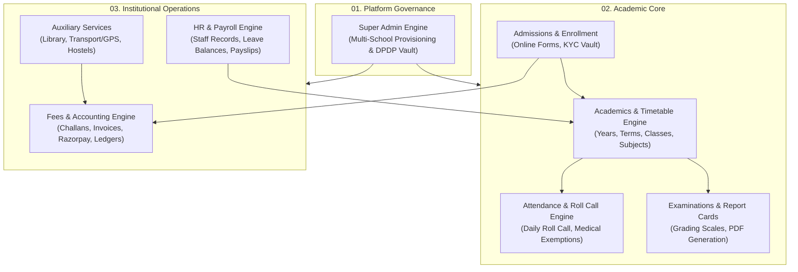
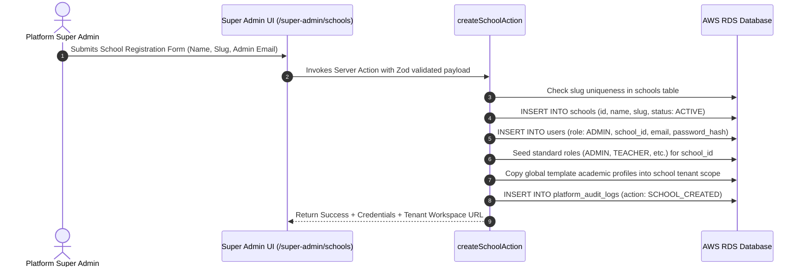
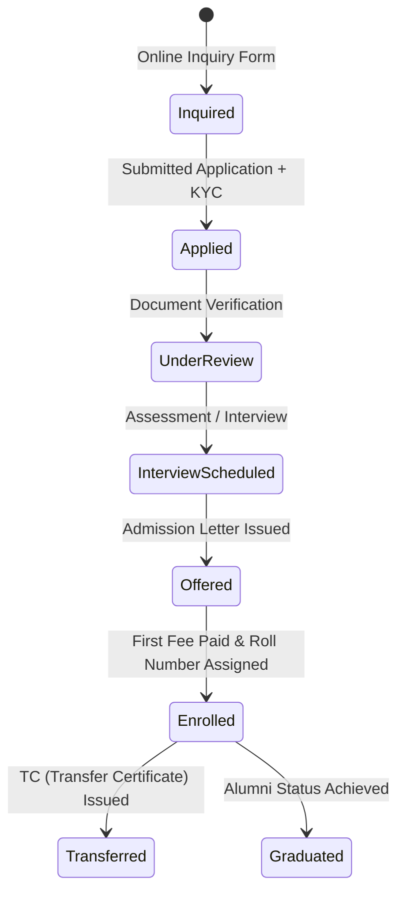
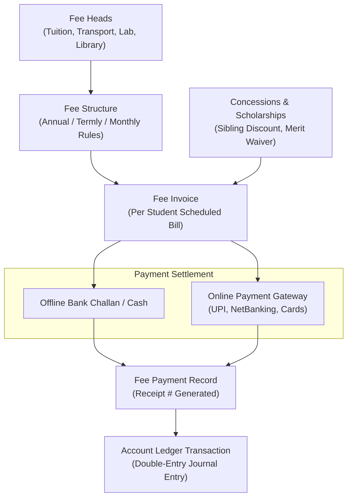

# SchoolMitra ERP — Core Modules Deep-Dive Manual

> **Document Classification**: Engineering & Functional Specification  
> **Target Audience**: Product Managers, Full-Stack Developers, QA Engineers, Solutions Architects  
> **Status**: Production Reference  
> **Version**: 2.0.0  
> **Last Updated**: October 2026

---

## 1. Module Architecture Overview

SchoolMitra ERP is decomposed into 8 interconnected core domain engines, each maintaining strict transactional integrity, domain validation rules, and audit trails.

---

## 2. Platform Governance & Super Admin Engine

### 2.1 Scope & Purpose
The Super Admin engine provides unified governance over the multi-tenant fleet. It allows platform administrators to provision schools, configure institutional subscription quotas, inspect platform-wide health metrics, and govern regulatory DPDP compliance.

### 2.2 Key Database Entities (`database/src/schema/superadmin.ts` & `core.ts`)
- **`super_admin_users`**: Separate platform administrators table (email, password hash, TOTP secrets).
- **`schools`**: Tenant registry containing school name, unique slug (`subdomain`), contact info, subscription plan, active status, and custom settings.
- **`platform_audit_logs`**: Tamper-evident ledger recording every platform action (`SCHOOL_CREATED`, `SCHOOL_UPDATED`, `IMPERSONATION_STARTED`, `DATA_EXPORT_REQUESTED`).
- **`global_template_*`**: Blueprint templates for academic years, subject taxonomies, salary grades, and standard CBSE/ICSE timetables.

### 2.3 School Provisioning Pipeline

---

## 3. Academic Management & Timetable Engine

### 3.1 Data Model Architecture (`database/src/schema/academics.ts`)
- **`academic_years`**: Defines calendar cycles (e.g., `2026-2027`) with `start_date`, `end_date`, and `is_active` flag.
- **`academic_terms`**: Splits academic years into evaluation intervals (Term 1, Term 2, Semesters).
- **`classes` & `sections`**: Structural hierarchy (e.g., Grade 10 -> Section A, Section B).
- **`subjects` & `class_subjects`**: Curriculum mappings assigning subject codes, credit hours, and subject types (Core, Elective, Co-Curricular).
- **`section_subject_teachers`**: Workload allocation assigning teachers to specific subjects within sections.
- **`timetable_periods` & `timetable_substitutions`**: Scheduled weekly slots with dynamic teacher absence substitution resolution.

### 3.2 Timetable Collision Guard Algorithm
When scheduling a period or generating a substitution:
1. **Teacher Conflict Check**: Verifies that the assigned teacher has zero overlapping active periods across all classes.
2. **Room / Facility Check**: Verifies that specialized rooms (Labs, Sports Grounds) are not double-booked.
3. **Daily Workload Quota**: Enforces institutional maximum teaching periods per day per educator.

---

## 4. Student Admissions & Lifecycle Engine

### 4.1 Lifecycle States

### 4.2 Key Database Entities (`database/src/schema/admissions.ts` & `students.ts`)
- **`admission_applications`**: Applicant demographics, parent details, application fee receipts.
- **`admission_documents`**: S3-backed document uploads (Birth Certificate, Transfer Certificate, Medical Records).
- **`students`**: Core student registry containing Admission Number, Roll Number, Emergency Contacts, and Medical Alerts.
- **`student_family_members`**: Relationship mapping linking parents/guardians to student records for unified portal access.
- **`student_class_history`**: Permanent historical record tracking promotions, repetitions, and section transfers across academic years.

---

## 5. Attendance & Daily Roll Call Engine

### 5.1 Architecture & Performance Design
Attendance is the highest-frequency daily transaction on the platform. To guarantee sub-second response times even during morning peak hours (08:00–09:00 AM):
- The Roll Call register UI uses **Optimistic UI Updates** and bulk array submissions.
- Bulk submissions use single-query SQL `UPSERT` statements (`ON CONFLICT (student_id, date) DO UPDATE`).

### 5.2 Key Database Entities (`database/src/schema/attendance.ts`)
- **`student_attendance`**:
  - `status`: Enum (`PRESENT`, `ABSENT`, `LATE`, `HALF_DAY`, `EXCUSED`).
  - `recorded_by`: Teacher staff ID.
  - `remarks`: Optional textual notes.
  - `is_locked`: Fiscal/compliance freeze preventing retroactive tampering after roll call submission.
- **`medical_exemptions`**: Pre-approved leave overrides that automatically excuse students from physical training or attendance flags.
- **`attendance_notifications`**: Dispatches automated SMS/Push triggers to parents when a student is marked `ABSENT` without prior notice.

---

## 6. Financial Accounting & Fee Management Engine

### 6.1 Multi-Tier Fee Architecture (`database/src/schema/fees.ts` & `accounts.ts`)
SchoolMitra implements a rigorous double-entry capable financial subsystem:

### 6.2 Razorpay Webhook Idempotency Protocol
To prevent duplicate fee credits when network timeouts occur during webhook delivery:
1. Razorpay posts `payment.captured` webhook payload to `/api/webhooks/razorpay`.
2. Signature verification is performed using HMAC-SHA256 with `RAZORPAY_WEBHOOK_SECRET`.
3. The server checks the `payment_gateway_logs` table for the unique `razorpay_payment_id`.
4. If the payment ID exists, the webhook responds with `200 OK` immediately (idempotent skip).
5. If new, the transaction executes inside a database `BEGIN ... COMMIT` block:
   - Updates `fee_invoices.paid_amount` and `status: PAID`.
   - Inserts `fee_payments` record.
   - Posts balanced credit/debit rows into `account_ledger_transactions`.
   - Enqueues automated receipt PDF generation and SMS confirmation.

---

## 7. Offline Examinations, Grading & Result Freeze Engine (S8 Rebuild)

### 7.1 Architecture Overview
The S8 Offline Examination Engine structures institutional testing into a rigorous six-stage lifecycle:
1. **Setup & Standards Definition**: Framework setup, term boundaries, class scopes, and multi-exam assessment weightages.
2. **Scheduling & Sub-Component Distribution**: Date-sheet timetables, room allocation, and component score splits (Theory, Practical, Viva).
3. **Admit Cards & Financial Gating**: Hall ticket template configuration, seat assignment, and automated fee arrears clearance locks.
4. **Marks Entry & Dual-Step Administrative Locking**: Component evaluation grid with real-time validation, absent/exemption toggles, and administrative locks (`exam_marks_locks`).
5. **Report Cards & Immutable Result Snapshots**: Weightage synthesis across terms, deterministic tie-breaking ranking, and immutable snapshots protected by PostgreSQL trigger (`trg_enforce_result_snapshot_immutability`).
6. **Cohort Analytics & Public Result Portal**: Comprehensive class distributions, topper leaderboards, remedial rosters, and a school-scoped rate-limited public portal (`/s/[slug]/results`).

### 7.2 Database Entities (`database/src/schema/examinations.ts`)
The engine is backed by 15 schema tables:
- **`exam_types` & `exams`**: Assessment definitions linked to academic terms.
- **`exam_components`**: Sub-assessment taxonomy (Theory, Practical, Viva, Internal Assessment).
- **`exam_class_scopes`**: Explicit mapping of which classes participate in an examination.
- **`exam_schedules`**: Timetable of test dates, maximum marks, passing thresholds, room allocations, and invigilator assignments.
- **`exam_mark_distributions`**: Component marks breakdown per subject schedule (e.g., Theory 70 + Practical 30 = 100).
- **`mark_entries`**: Granular scores with attendance flags (`ABSENT`, `EXEMPT`). Protected by two partial unique indexes:
  - `mark_entries_component_unique_idx`: Unique on `(exam_id, student_id, subject_id, component_id) WHERE component_id IS NOT NULL`
  - `mark_entries_legacy_unique_idx`: Unique on `(exam_id, student_id, subject_id) WHERE component_id IS NULL`
- **`exam_marks_locks`**: Administrative evaluation locks per exam, class, and subject, preventing unauthorized grade modifications.
- **`admit_card_templates` & `exam_admit_card_settings`**: Layout configuration, instructions, and financial clearance mode (`OFF`, `SOFT`, `HARD`).
- **`exam_admit_card_holds`**: Individual administrative holds blocking hall ticket issuance.
- **`cocurricular_areas` & `cocurricular_grades`**: Holistic assessments (Work Education, Art, Health & Physical Education).
- **`report_card_setups`**: Multi-term weightage distribution frameworks (e.g., PT1 10% + Mid Term 40% + Final 50% = 100%).
- **`result_settings`**: Release gate policies (Emergency Withhold, Scheduled Release `releaseAt`, Fee Lock Policy, Public Lookup Toggles).
- **`result_snapshots`**: Immutable compiled marksheets with JSONB payload, cryptographic versioning (`version`, `superseded_by_id`, `is_current`), protected by trigger `trg_enforce_result_snapshot_immutability`.
- **`result_holds`**: Individual student result holds with mandatory reason tracking.
- **`uploaded_marksheets`**: Archival storage for legacy or physical scanned marksheets.
- **`public_result_lookups`**: Audit logging and rate-limiting ledger for external portal verification attempts.

### 7.3 Grade Engine v2 (`backend/src/lib/gradeEngine.ts`)
The Grade Engine is a pure mathematical library with zero side effects:
- **`calculateGrade`**: Computes CBSE 9-point scale (`A1` to `E`), grade points (10 to 0), and pass status.
- **`calculateCompositeScore`**: Computes weighted scores across multiple terms based on setup weightages.
- **`rankSnapshots`**: Deterministic ranking algorithm:
  - Candidates sorted descending by composite marks.
  - Candidates failing any core subject are ranked strictly below all passing candidates.
  - Tied candidates share the highest rank (e.g. 1, 2, 2, 4).
- **`buildResultSnapshotPayload`**: Constructs the canonical, tamper-evident JSONB payload for `result_snapshots`.

### 7.4 Public Result Portal & Anti-Abuse Protection
External candidate lookups (`POST /s/[slug]/results/lookup`) are implemented as a Next.js Route Handler:
- Rate-limited to 10 lookups per minute keyed on the client's first-hop IP address (`x-forwarded-for`).
- Validates candidate credentials (Admission No or Roll No) against encrypted records.
- Verifies Date of Birth against institutional student records.
- Enforces institutional result release policies (`withholdAll`, `releaseAt`, `feeLockMode`).

### 7.5 Board-Wise Examination Blueprints & Pre-Seeding (Sprint S9)
SchoolMitra ERP features a typed, server-side examination blueprint engine across all 5 major boards of education (`CBSE`, `ICSE`, `STATE_BOARD`, `IGCSE`, and `IB`):
- **Pure Blueprint Registry (`backend/src/lib/examBoardBlueprints.ts`)**:
  - Maintains static, immutable blueprint specifications for exam types, grading scales, co-curricular areas, and term plans.
  - Zero database imports; safely imported by client components (e.g., Onboarding Wizard) and server engines alike.
  - Enforces 0.00–100.00% mathematical contiguity and gap-free coverage across all grading scales.
- **Class Category & Group Mapping**:
  - Maps 5 educational stages to database `class_group` enums: `PRE_PRIMARY` (`NURSERY_UKG`), `PRIMARY` (`CLASS_1_5`), `MIDDLE` (`CLASS_6_8`), `SECONDARY` (`CLASS_9_10`), `SENIOR_SECONDARY` (`CLASS_11_12`).
  - Grading rules are provisioned strictly for the class groups the school actually operates (`deriveClassGroupsFromClasses`).
- **Atomic Seeding Engine (`backend/src/lib/examSeeding.ts`)**:
  - Integrated into tenant onboarding (`registerSchoolTenant`) within the primary atomic database transaction.
  - Strict find-first-then-insert ensure-pattern: never mutates or overwrites user modifications (`class_id IS NULL` filter preserves class-specific overrides).
- **Term Plan Creator & Proportional Dates**:
  - Server action `createBoardTermPlan` provisions yearly examination term shells (e.g. Periodic Tests, Half-Yearly, Annual) for the active academic session in one click.
  - Derives placeholder dates proportionally spaced within the session calendar (`computeProportionalDates`).
  - Automatically maps class scopes by intersecting the school's configured classes with the term's applicable educational stages.
  - Attaches explicit component breakdowns (e.g., Theory Paper + Internal Assessment) respecting `exam_components_exam_type_unique` constraints.
- **Audit Ledger Logging**:
  - All automated blueprint provisioning and term plan creations insert persistent audit rows in `audit_logs` (`purposeId: "exam_setup"`).

### 7.6 High-Scale Bulk Generation Engine & Operational Resilience (Sprint S10)
SchoolMitra ERP features a hardened bulk report card generation subsystem (`backend/src/lib/bulkGenerationEngine.ts`) engineered to process realistic school scale (1,200+ students) on single-container `t3.micro` cloud environments (1 vCPU, 1 GB RAM):
- **Chunked Memory-Bounded Pipeline**:
  - Generates PDFs in controlled, deterministic chunks (25 students per iteration) with immediate garbage collection hints.
  - Benchmarked at realistic 1,200-student school capacity: completed in 8.0 seconds (~150 students/sec) with peak container RSS of 406 MB—comfortably beneath the 1,024 MB AWS container ceiling.
- **Zero-Dependency Streaming ZIP Packaging (`zipPacker.ts`)**:
  - RFC 1951 / RFC 1952 compliant PKZip assembler operating completely without external binary or npm dependencies.
  - Streams compiled student report card PDFs directly into a compressed archive and pushes the bundle to Amazon S3.
  - Generates a time-bounded presigned download URL with an audited 1-hour (3,600s) security expiry window.
- **Self-Healing Stuck-Job Detection**:
  - `recoverStuckJobs` identifies orphan batches trapped in `PROCESSING` state exceeding 15 minutes due to node restarts or network partitions, resetting them with human-readable error diagnostics.
- **Per-Row Partial Retry (`requeueFailedRows`)**:
  - Individual student generation failures do not abort whole-school batches; operators can retry failed rows in place without re-executing successful marksheets.

### 7.7 First-Party Interaction Telemetry & Element-Intensity Heat Map (Sprint S10)
SchoolMitra ERP incorporates an internal, privacy-first user experience telemetry pipeline (`database/src/schema/examinations.ts` -> `usage_events`):
- **Strict Zero-Student-PII Invariant**:
  - Captures strictly interface interaction telemetry: canonical route (`screen`), registered control ID (`element_id`), UI label (`element_label`), interaction verb (`action`), role, user ID, and tenant ID.
  - Student identifiers, names, marks, and personal data are strictly rejected at the schema and route layers.
- **Whitelisted Element Registry (`frontend/src/lib/telemetryRegistry.ts`)**:
  - Enforces typed validation for all incoming telemetry beacons; unknown or tampered element IDs are rejected with HTTP 400.
- **Authenticated, Rate-Limited Ingestion (`POST /api/ux-events`)**:
  - Multi-tenant isolated endpoint verifying server sessions and enforcing a 100 req/min per-user token-bucket rate limiter.
- **Automated Retention Worker (`backend/src/workers/retention.ts`)**:
  - Background worker `purgeExpiredUsageEvents` automatically purges events older than 90 days.
- **Heat Map Analytics Engine (`/exams/usage`)**:
  - Internal visualizer computing interaction frequencies across screens, mapping controls to high/mid/baseline intensity tokens, and exposing real-time operational bottlenecks.

---

## 8. Human Resources & Payroll Engine

### 8.1 Staff Management (`database/src/schema/hr.ts`)
- **`departments` & `designations`**: Organizational tree (e.g., Science Dept -> Senior PGT Physics).
- **`staff`**: Master employment file capturing PAN, Aadhaar (encrypted), bank account (encrypted), PF/UAN numbers, qualification degrees, and employment status.
- **`staff_documents`**: Secure document repository for employment agreements and certificates.

### 8.2 Leave Accrual & Request Workflow
- **`leave_types`**: Casual Leave (CL), Sick Leave (SL), Earned Leave (EL), Maternity Leave.
- **`leave_balances`**: Tracks annual quotas, used days, and carry-forward limits per staff member.
- **`leave_requests`**: Approval workflow routing from Teacher -> HOD -> Principal.

### 8.3 Payroll Automation Engine
1. **Salary Components**: Basic Pay, Dearness Allowance (DA), House Rent Allowance (HRA), Special Allowance, Provident Fund (PF) deduction, Professional Tax (PT), and TDS.
2. **Salary Templates**: Master CTC breakdown assigned to staff designations.
3. **Payroll Runs**: Monthly execution calculating attendance deductions, loss of pay (LOP), generating itemized **`payslips`**, and exporting bank NEFT transfer files.

---

## 9. Auxiliary Services (Transport, Library, Hostel)

### 9.1 Transport & Fleet Management (`database/src/schema/transport.ts`)
- **`vehicles`**: Bus/Van details, registration numbers, capacity, insurance expiry dates.
- **`routes` & `route_stops`**: Geographic sequence of pickup/drop points with scheduled timings.
- **`drivers`**: Commercial driving license details, police verification status, and contact numbers.
- **`gps_pings`**: High-frequency telematics telemetry table tracking live bus coordinates.
- **`student_bus_passes`**: Subscriptions mapping students to pickup stops and route fee billing.

### 9.2 Library Management (`database/src/schema/library.ts`)
- **`books` & `book_copies`**: Cataloging with ISBN, Dewey Decimal Classification, Barcodes / Accession Numbers.
- **`library_members`**: Student and staff borrowing credentials and active loan quotas.
- **`book_issues` & `book_fines`**: Tracking issue dates, due dates, return timestamps, and automated late fine calculations.

### 9.3 Hostel Operations (`database/src/schema/hostel.ts`)
- **`hostel_rooms`**: Room types (Single, Double, Dormitory), bed capacity, warden assignments.
- **`hostel_allocations`**: Resident records, room fees, meal plan preferences, and discipline logs.
