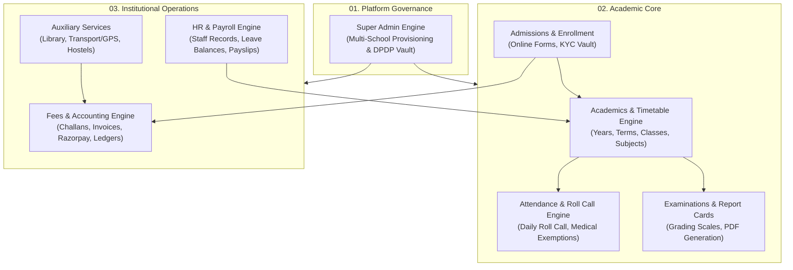
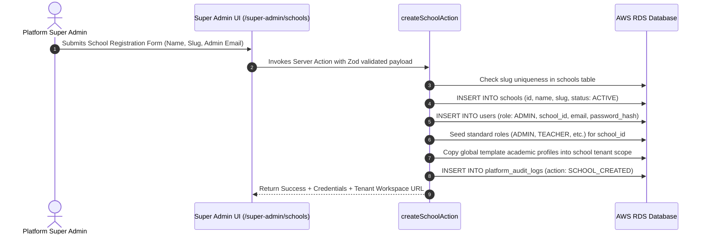
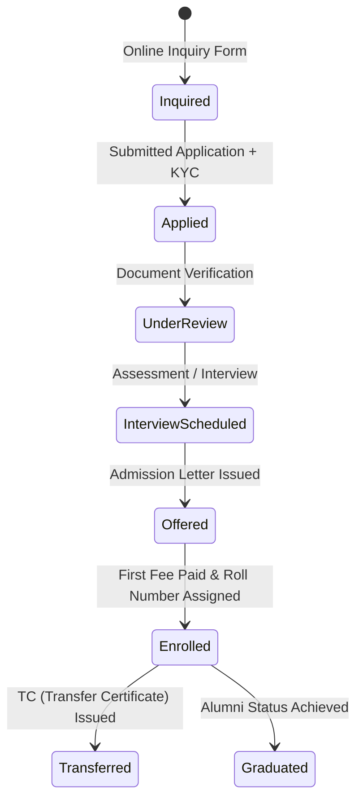
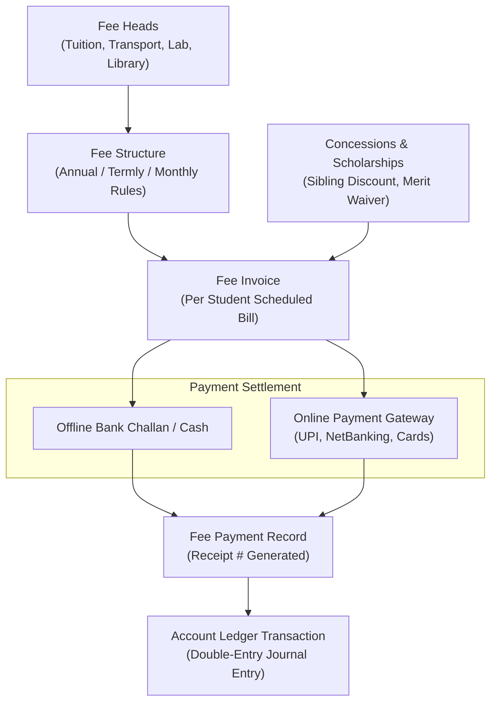

# SchoolMitra ERP — Core Modules Deep-Dive Manual

> **Document Classification**: Engineering & Functional Specification  
> **Target Audience**: Product Managers, Full-Stack Developers, QA Engineers, Solutions Architects  
> **Status**: Production Reference  
> **Version**: 2.0.0  
> **Last Updated**: October 2026

---

## 1. Module Architecture Overview

SchoolMitra ERP is decomposed into 8 interconnected core domain engines, each maintaining strict transactional integrity, domain validation rules, and audit trails.

---

## 2. Platform Governance & Super Admin Engine

### 2.1 Scope & Purpose
The Super Admin engine provides unified governance over the multi-tenant fleet. It allows platform administrators to provision schools, configure institutional subscription quotas, inspect platform-wide health metrics, and govern regulatory DPDP compliance.

### 2.2 Key Database Entities (`database/src/schema/superadmin.ts` & `core.ts`)
- **`super_admin_users`**: Separate platform administrators table (email, password hash, TOTP secrets).
- **`schools`**: Tenant registry containing school name, unique slug (`subdomain`), contact info, subscription plan, active status, and custom settings.
- **`platform_audit_logs`**: Tamper-evident ledger recording every platform action (`SCHOOL_CREATED`, `SCHOOL_UPDATED`, `IMPERSONATION_STARTED`, `DATA_EXPORT_REQUESTED`).
- **`global_template_*`**: Blueprint templates for academic years, subject taxonomies, salary grades, and standard CBSE/ICSE timetables.

### 2.3 School Provisioning Pipeline

---

## 3. Academic Management & Timetable Engine

### 3.1 Data Model Architecture (`database/src/schema/academics.ts`)
- **`academic_years`**: Defines calendar cycles (e.g., `2026-2027`) with `start_date`, `end_date`, and `is_active` flag.
- **`academic_terms`**: Splits academic years into evaluation intervals (Term 1, Term 2, Semesters).
- **`classes` & `sections`**: Structural hierarchy (e.g., Grade 10 -> Section A, Section B).
- **`subjects` & `class_subjects`**: Curriculum mappings assigning subject codes, credit hours, and subject types (Core, Elective, Co-Curricular).
- **`section_subject_teachers`**: Workload allocation assigning teachers to specific subjects within sections.
- **`timetable_periods` & `timetable_substitutions`**: Scheduled weekly slots with dynamic teacher absence substitution resolution.

### 3.2 Timetable Collision Guard Algorithm
When scheduling a period or generating a substitution:
1. **Teacher Conflict Check**: Verifies that the assigned teacher has zero overlapping active periods across all classes.
2. **Room / Facility Check**: Verifies that specialized rooms (Labs, Sports Grounds) are not double-booked.
3. **Daily Workload Quota**: Enforces institutional maximum teaching periods per day per educator.

---

## 4. Student Admissions & Lifecycle Engine

### 4.1 Lifecycle States

### 4.2 Key Database Entities (`database/src/schema/admissions.ts` & `students.ts`)
- **`admission_applications`**: Applicant demographics, parent details, application fee receipts.
- **`admission_documents`**: S3-backed document uploads (Birth Certificate, Transfer Certificate, Medical Records).
- **`students`**: Core student registry containing Admission Number, Roll Number, Emergency Contacts, and Medical Alerts.
- **`student_family_members`**: Relationship mapping linking parents/guardians to student records for unified portal access.
- **`student_class_history`**: Permanent historical record tracking promotions, repetitions, and section transfers across academic years.

---

## 5. Attendance & Daily Roll Call Engine

### 5.1 Architecture & Performance Design
Attendance is the highest-frequency daily transaction on the platform. To guarantee sub-second response times even during morning peak hours (08:00–09:00 AM):
- The Roll Call register UI uses **Optimistic UI Updates** and bulk array submissions.
- Bulk submissions use single-query SQL `UPSERT` statements (`ON CONFLICT (student_id, date) DO UPDATE`).

### 5.2 Key Database Entities (`database/src/schema/attendance.ts`)
- **`student_attendance`**:
  - `status`: Enum (`PRESENT`, `ABSENT`, `LATE`, `HALF_DAY`, `EXCUSED`).
  - `recorded_by`: Teacher staff ID.
  - `remarks`: Optional textual notes.
  - `is_locked`: Fiscal/compliance freeze preventing retroactive tampering after roll call submission.
- **`medical_exemptions`**: Pre-approved leave overrides that automatically excuse students from physical training or attendance flags.
- **`attendance_notifications`**: Dispatches automated SMS/Push triggers to parents when a student is marked `ABSENT` without prior notice.

---

## 6. Financial Accounting & Fee Management Engine

### 6.1 Multi-Tier Fee Architecture (`database/src/schema/fees.ts` & `accounts.ts`)
SchoolMitra implements a rigorous double-entry capable financial subsystem:

### 6.2 Razorpay Webhook Idempotency Protocol
To prevent duplicate fee credits when network timeouts occur during webhook delivery:
1. Razorpay posts `payment.captured` webhook payload to `/api/webhooks/razorpay`.
2. Signature verification is performed using HMAC-SHA256 with `RAZORPAY_WEBHOOK_SECRET`.
3. The server checks the `payment_gateway_logs` table for the unique `razorpay_payment_id`.
4. If the payment ID exists, the webhook responds with `200 OK` immediately (idempotent skip).
5. If new, the transaction executes inside a database `BEGIN ... COMMIT` block:
   - Updates `fee_invoices.paid_amount` and `status: PAID`.
   - Inserts `fee_payments` record.
   - Posts balanced credit/debit rows into `account_ledger_transactions`.
   - Enqueues automated receipt PDF generation and SMS confirmation.

---

## 7. Examination, Grading & Report Cards Engine

### 7.1 Data Model Architecture (`database/src/schema/examinations.ts`)
- **`exam_types`**: Formative Assessment (FA), Summative Assessment (SA), Unit Tests, Prelims.
- **`exams`**: Specific examination instances linked to academic terms.
- **`exam_schedules`**: Timetable of test dates, maximum marks, passing thresholds, and invigilators.
- **`mark_entries`**: Granular scores per student, per subject, including component splits (Theory, Practical, Viva).
- **`grade_rules`**: Configurable grading scales (CBSE 9-point scale, ICSE percentages, Letter grades A+ to F).
- **`report_cards`**: Compiled term evaluations, teacher remarks, attendance percentages, and overall GPA.
- **`report_card_jobs`**: Asynchronous batch rendering jobs processed by `backend/src/workers/reportCard.ts`.

---

## 8. Human Resources & Payroll Engine

### 8.1 Staff Management (`database/src/schema/hr.ts`)
- **`departments` & `designations`**: Organizational tree (e.g., Science Dept -> Senior PGT Physics).
- **`staff`**: Master employment file capturing PAN, Aadhaar (encrypted), bank account (encrypted), PF/UAN numbers, qualification degrees, and employment status.
- **`staff_documents`**: Secure document repository for employment agreements and certificates.

### 8.2 Leave Accrual & Request Workflow
- **`leave_types`**: Casual Leave (CL), Sick Leave (SL), Earned Leave (EL), Maternity Leave.
- **`leave_balances`**: Tracks annual quotas, used days, and carry-forward limits per staff member.
- **`leave_requests`**: Approval workflow routing from Teacher -> HOD -> Principal.

### 8.3 Payroll Automation Engine
1. **Salary Components**: Basic Pay, Dearness Allowance (DA), House Rent Allowance (HRA), Special Allowance, Provident Fund (PF) deduction, Professional Tax (PT), and TDS.
2. **Salary Templates**: Master CTC breakdown assigned to staff designations.
3. **Payroll Runs**: Monthly execution calculating attendance deductions, loss of pay (LOP), generating itemized **`payslips`**, and exporting bank NEFT transfer files.

---

## 9. Auxiliary Services (Transport, Library, Hostel)

### 9.1 Transport & Fleet Management (`database/src/schema/transport.ts`)
- **`vehicles`**: Bus/Van details, registration numbers, capacity, insurance expiry dates.
- **`routes` & `route_stops`**: Geographic sequence of pickup/drop points with scheduled timings.
- **`drivers`**: Commercial driving license details, police verification status, and contact numbers.
- **`gps_pings`**: High-frequency telematics telemetry table tracking live bus coordinates.
- **`student_bus_passes`**: Subscriptions mapping students to pickup stops and route fee billing.

### 9.2 Library Management (`database/src/schema/library.ts`)
- **`books` & `book_copies`**: Cataloging with ISBN, Dewey Decimal Classification, Barcodes / Accession Numbers.
- **`library_members`**: Student and staff borrowing credentials and active loan quotas.
- **`book_issues` & `book_fines`**: Tracking issue dates, due dates, return timestamps, and automated late fine calculations.

### 9.3 Hostel Operations (`database/src/schema/hostel.ts`)
- **`hostel_rooms`**: Room types (Single, Double, Dormitory), bed capacity, warden assignments.
- **`hostel_allocations`**: Resident records, room fees, meal plan preferences, and discipline logs.
