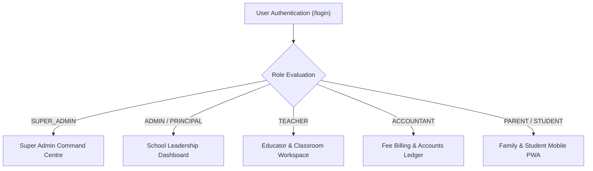
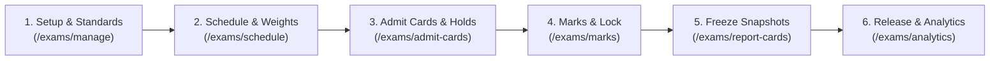

# SchoolMitra ERP — End-User Operations Manual & Role Playbooks

> **Document Classification**: User Manual & Operational Playbooks  
> **Target Audience**: School Principals, Administrators, Teachers, Accountants, Parents, Students  
> **Status**: Official Production Guide  
> **Version**: 2.0.0  
> **Last Updated**: October 2026

---

## 1. User Guide Overview

SchoolMitra ERP is designed with role-tailored workspaces. When users log in, the navigation interface dynamically configures to match their exact responsibilities and security clearance.

---

## 2. Platform Super Administrator Playbook

### 2.1 Workspace Access
- **URL**: `http://educore-alb-1749225371.ap-south-1.elb.amazonaws.com/super-admin`
- **Permissions**: Fleet-wide control, multi-school provisioning, platform analytics, DPDP compliance vault.

### 2.2 Standard Operating Procedures

#### SOP SA-01: Onboarding a New School
1. Log into the Super Admin dashboard using platform credentials.
2. Navigate to **School Management** in the primary sidebar.
3. Click the **+ New School** button in the top right.
4. Fill in the required parameters:
   - **School Name**: Official legal name of the educational institution (e.g., `St. Xavier's International School`).
   - **Subdomain Slug**: Unique lowercase identifier (e.g., `stxaviers` -> `stxaviers.schoolmitra.in`).
   - **Contact Email**: Principal or institutional administrative contact email.
   - **Subscription Tier**: Select tier (`STARTER`, `GROWTH`, `ENTERPRISE`) based on active student enrollment quotas.
5. Click **Provision School**. The platform generates the tenant entry, seeds core roles, copies default academic template profiles, and dispatches the activation link.

#### SOP SA-02: Tenant Workspace Impersonation (Support Mode)
1. In the **School Management** table, locate the target school.
2. Click **Actions (⋮)** -> **Access School Workspace**.
3. Select an audit justification reason (e.g., `Troubleshooting Fee Challan Generation - Ticket #402`).
4. Click **Proceed with Impersonation**.
5. The platform establishes an audited 30-minute session and opens the school dashboard with an amber **IMPERSONATION ACTIVE** banner.
6. When diagnostic work is concluded, click **Exit Impersonation** in the banner to return to the platform console.

#### SOP SA-03: DPDP Privacy Vault Audits
1. Navigate to **DPDP Privacy Vault** (`/super-admin/dpdp`).
2. Review platform-wide consent metrics, active data retention policies, and cross-school data principal access requests.
3. If an emergency security event occurs, log the formal statutory incident via the **Log Breach Incident** modal within the mandated 6-hour regulatory window.

---

## 3. School Principal & Institutional Administrator Playbook

### 3.1 Workspace Access
- **URL**: Institutional subdomain or primary portal login (`/admin` / `/principal`).
- **Permissions**: School-level master configurations, staff management, academic scheduling, calendar approvals.

### 3.2 Standard Operating Procedures

#### SOP AD-01: Initial Academic Year Setup
1. Open **Academics** -> **Academic Years**.
2. Click **Create Academic Year** (e.g., `2026-2027`).
3. Set the official session start date (e.g., `June 1, 2026`) and session end date (e.g., `May 31, 2027`).
4. Configure terms (e.g., `Term 1: June – October`, `Term 2: November – March`).
5. Set the new year as **Active**. All subsequent classes, sections, and student rosters will link to this active cycle.

#### SOP AD-02: Staff Member Onboarding
1. Navigate to **Staff & HR** -> **Staff Directory**.
2. Click **+ Add Staff Member**.
3. Enter employment details:
   - Full Name, Gender, Date of Birth, Emergency Contact.
   - Designation (e.g., `PGT Mathematics`) and Department (`Senior Secondary`).
   - Assign Primary Role (e.g., `TEACHER`, `ACCOUNTANT`, `LIBRARIAN`).
4. Set official joining date and assign salary grade template.
5. Provide login credentials; the staff member receives an automated activation email to set up their password.

#### SOP AD-03: Six-Stage Offline Examination Operations Lifecycle
The S8 Offline Examination Module follows a strict six-stage lifecycle engineered for accuracy, auditability, and academic integrity:

1. **Stage 1 — Exam Creation & Grading Standards** (`/exams/manage` & `/exams/dashboard`):
   - **Automated Blueprint Onboarding**: When a school completes initial onboarding (`/onboard`), selecting their affiliation board (`CBSE`, `ICSE`, `STATE_BOARD`, `IGCSE`, or `IB`) automatically provisions foundational exam types, 0–100% gap-free grade rules across operated class levels, and co-curricular domains with descriptions ending in `"Board default (editable)"`.
   - **Load Board Defaults for Existing Schools**: Existing schools without pre-seeded configurations can click **Load Board Defaults** in `/exams/manage` to provision missing defaults in one click without altering custom overrides.
   - **One-Click Board Term Plan Creation**: In `/exams/dashboard`, click **Create Board Term Plan** to open the Confirmation Drawer. The engine displays the exact term shells, proportionally derived dates within the academic session, automatically intersected class scopes, and explicit component weightages (e.g. Theory 80% + Internal 20%) before confirmation. Idempotency guarantees existing shells are skipped without duplicate creation.
   - **Manual Exam Setup & Class Preselection**: Click **+ Create Exam** or **New Exam Setup**:
     - Step 1: Provide Exam Name, select Exam Type, and enter Start/End dates.
     - Step 2: The system automatically preselects classes matching the chosen exam type's educational group (e.g., Pre-Primary, Middle, Senior Secondary), while preserving full manual override capability.
     - Step 3: Configure assessment components and report card visibility.
2. **Stage 2 — Timetable & Component Mark Distributions** (`/exams/schedule`):
   - Navigate to **Examinations** -> **Schedules & Timetable**.
   - For each class and subject, configure the datesheet: Exam Date, Start/End Time, Room/Venue, and Maximum Marks.
   - Click **Component Breakdown** to assign multi-component weights (e.g., Theory: 70 marks, Practical: 20 marks, Viva/Project: 10 marks). Total component weights are strictly validated to equal subject maximum marks.
3. **Stage 3 — Admit Card Generation & Fee Defaulter Policy** (`/exams/admit-cards`):
   - Open **Examinations** -> **Admit Cards**.
   - Configure issuance policies: Set Fee Clearance Threshold (e.g., maximum allowable unpaid balance of ₹500) and Mandatory Attendance threshold (e.g., 75%).
   - Select an Admit Card Template (`CBSE_STANDARD`, `MODERN_MINIMAL`, `COMPACT_SLIP`).
   - Click **Generate Batch Admit Cards**. Students exceeding the fee threshold are placed on **Fee Hold** with automated notice slips generated for parents.
4. **Stage 4 — Marks Entry & Administrative Locking** (`/exams/marks`):
   - Administrators and Exam Incharges monitor incoming marks from the central register.
   - To prevent post-submission tampering, click **Lock Marks Entry** for completed subjects or entire classes.
   - Once locked, teachers cannot alter marks without a formal administrative unlock action with an audit justification.
5. **Stage 5 — Result Calculation, Rank Generation & Snapshot Freeze** (`/exams/report-cards`):
   - Navigate to **Examinations** -> **Report Cards**.
   - Click **Calculate Ranks & Results**. The engine computes student totals, percentages, grade conversions, class ranks, and section ranks.
   - Configure a Report Card Setup (`/exams/report-cards/setups`): Header banner, grading key display, co-curricular matrices, and authorized signature blocks.
   - Click **Freeze Result Snapshots**. The system copies student results into immutable `result_snapshots` records protected by database triggers (`trg_enforce_result_snapshot_immutability`).
6. **Stage 6 — Release Gate, Portal Publication & Cohort Analytics** (`/exams/report-cards/settings` & `/exams/analytics`):
   - Set the Result Release Gate to `PUBLISHED` when leadership approves distribution.
   - Review institutional performance in `/exams/analytics`: Pass percentage, CBSE bell-curve distributions, subject comparative analysis, topper leaderboards, and students requiring remedial academic intervention.

#### SOP AD-04: Result Release Gate & Controlled Visibility
1. Open **Examinations** -> **Report Cards** -> **Release Settings** (`/exams/report-cards/settings`).
2. Configure distribution channels:
   - **Parent & Student Portal Access**: Toggle `Allow Parent Portal Download`. Set date/time for scheduled release if publishing in the future.
   - **Fee Defaulter Gate for Results**: Set whether students with outstanding dues can download official report cards or see a clearance notice.
   - **Public Result Verification Portal**: Enable `School Public Result Verification` to allow students, universities, and alumni to verify marks online via the school's public slug (`/s/[slug]/results`).
3. If an error is identified post-freeze, administrators issue a revised snapshot. The previous snapshot is flagged as superseded (`superseded_by_id`) ensuring an unbroken academic audit trail.

#### SOP AD-05: High-Scale Bulk Report Card Batch Generation & Resilient Recovery (Sprint S10)
1. **Initiate Bulk Generation**:
   - Navigate to **Examinations** -> **Report Cards** (`/exams/report-cards`).
   - Select the target class or entire grade level and click **Generate Bulk Report Cards**.
   - The engine processes marksheets in non-blocking 25-student chunks to prevent container memory exhaustion.
2. **Track Batch Execution & Progress**:
   - View real-time progress cards indicating total records, processed students, and chunk indicators.
   - For an entire 1,200-student school, processing finishes in under 15 seconds.
3. **Download Secure Batch ZIP**:
   - Once compilation is complete, click **Download Bulk ZIP Archive**.
   - The platform streams the RFC 1951 compressed PKZip file directly from Amazon S3 via a temporary presigned URL valid for 1 hour (3,600s).
4. **Resilient Recovery & Partial Retry**:
   - **Per-Row Partial Retry**: If individual student rows fail due to invalid template configurations or missing photo assets, click **Retry Failed Rows** (`requeueFailedRows`) to re-execute only the failed marksheets without regenerating successful cards.
   - **Stuck-Job Self-Healing**: Batches lingering in `PROCESSING` state for more than 15 minutes due to network drops are automatically detected and transitioned to recoverable state with diagnostic logs.

#### SOP AD-06: Monitoring Examination Subsystem Telemetry & Element Heat Map (Sprint S10)
1. **Accessing the Heat Map Console**:
   - From the Examinations Operations dashboard (`/exams/dashboard`), click **Usage & Heat Map** in the header.
   - Authorized roles: `SUPER_ADMIN`, `SCHOOL_ADMIN`, and `PRINCIPAL` with `exam.usage.view`.
2. **Filtering Interaction Telemetry**:
   - **Screen Route**: Select target surface (e.g. `/exams/marks`, `/exams/dashboard`, `/exams/manage`, `/teacher/grading`).
   - **Timeline Window**: Filter by 24 Hours, 7 Days, 30 Days, or All-Time.
   - **Role Breakdown**: Filter by School Admin, Principal, or Teacher interactions.
3. **Interpreting Element Heat Map Badges**:
   - **High Intensity (Rose / Flame)**: Elements with >30 interaction hits (e.g., Save Marks button, Class Filter).
   - **Mid Intensity (Amber / Activity)**: Elements with 11–30 interaction hits (e.g., Datesheets, Pending Marks card).
   - **Baseline (Slate)**: Elements with <=10 hits.
4. **Utilizing Frequency-Repositioned Ergonomics**:
   - **Dual Save Placement on `/exams/marks`**: Use either the top toolbar save button or the Adaptive Sticky Action Dock docked in the thumb zone at the bottom of the viewport (`UX-R20`), ensuring immediate 1-tap save access without scrolling back up long student lists.
   - **Options Overflow Menu (`UX-R10`)**: Access secondary features (Lock/Unlock subject marks, Export Marks CSV, Discard edits) under the Options menu to maintain uninterrupted focus on grading.
   - **Unsaved Changes Indicator**: Watch the pulsing amber beacon in the sticky dock for real-time unsaved edits confirmation.

---

## 4. Teacher & Educator Playbook

### 4.1 Workspace Access
- **URL**: Institutional subdomain (`/teacher`).
- **Permissions**: Classroom roll call, student grading workspace (`/teacher/grading`), lesson planning, student notes.
- **Security Boundary**: Per strict institutional RBAC policy, teachers are restricted from `/exams/*` administrative routes and evaluate students exclusively within the teacher grading workspace.

### 4.2 Standard Operating Procedures

#### SOP TC-01: Morning Attendance Roll Call
1. Log into the Educator Workspace.
2. Select your assigned **Class & Section** (e.g., `Class 10 — Section A`).
3. The register automatically loads enrolled students in alphabetical order by Roll Number.
4. **Fast Marking**:
   - Tap **Mark All Present** to initialize the roster.
   - Individually tap any absent students to toggle their status to **Absent** (red badge) or **Late** (yellow badge).
5. If a student has an approved medical leave, the system displays an indicator: **Medical Exemption Active**.
6. Review totals in the summary bar (Enrolled, Present, Absent, Late).
7. Tap **Submit Attendance Register**. The roll call is locked, and parent notification alerts are automatically queued for any absent students.

#### SOP TC-02: Teacher Grading Workspace (`/teacher/grading`)
1. Navigate to **Academic Evaluations** -> **Grading Workspace** (`/teacher/grading`).
2. The system evaluates `assertTeacherTeaches` to present only the classes, sections, and subjects officially assigned to you in the master timetable.
3. Select the Exam (e.g., `Half-Yearly Examination 2026-27`), Class/Section, and Subject.
4. The grading matrix dynamically renders based on whether the exam uses holistic marks or multi-component breakdown:
   - **Component Breakdown**: Enter marks into distinct columns for **Theory** (e.g., /70), **Practical** (e.g., /20), and **Internal/Viva** (e.g., /10).
   - **Status Flags**: Check **Absent (AB)** or **Medical Exemption (EX)** where appropriate.
5. Auto-Save & Validation:
   - Marks exceeding the component maximum are highlighted in red with form submission blocked.
   - Edits are saved in real-time drafts.
6. **Administrative Lock Notice**:
   - If the exam incharge or administrator has locked the marks for this subject, a lock badge (`🔒 Marks Locked by Admin`) is displayed and input cells become read-only.
   - If marks need amendment post-locking, contact the Examination Department to request a formal administrative unlock.

---

## 5. Fee Accountant Playbook

### 5.1 Workspace Access
- **URL**: Institutional subdomain (`/accountant`).
- **Permissions**: Fee collection, invoice generation, discount waivers, bank reconciliation, ledger reports, exam admit card fee clearance.

### 5.2 Standard Operating Procedures

#### SOP AC-01: Generating Term Invoices
1. Navigate to **Fees** -> **Fee Invoices**.
2. Click **Generate Batch Invoices**.
3. Select the Academic Term and target Classes (e.g., `All Primary Classes`).
4. Review calculated totals based on assigned Fee Structures (Tuition + Computer Lab + Transport).
5. Click **Issue Invoices**. Invoices appear immediately in parent portals and trigger SMS fee due slips.

#### SOP AC-02: Offline Fee Collection (Counter Cash / Cheque)
1. Open **Fees** -> **Collect Fee**.
2. Search for the student by Admission Number, Student Name, or Parent Phone.
3. Select the unpaid invoice items.
4. Choose the Payment Mode: **Cash**, **Cheque/DD**, or **Direct Bank Transfer (NEFT)**.
   - For Cheques: Enter Cheque Number, Bank Name, and Cheque Date.
5. Click **Receive Payment & Print Receipt**.
6. The system generates an official receipt with a unique serial number and double-entry ledger journal entry, then downloads the printable PDF.

#### SOP AC-03: Admit Card Fee Clearance & Defaulter Holds
1. Navigate to **Fees** -> **Exam Clearance** or access **Examinations** -> **Admit Cards** (`/exams/admit-cards`).
2. View the **Fee Clearance Roster** prior to term examinations.
3. Students with outstanding balances exceeding the threshold (e.g., ₹500) are flagged with **Admit Card Blocked**.
4. When a parent clears outstanding dues at the cash counter or via UPI online:
   - The fee ledger automatically updates.
   - The hold is lifted instantly in real-time, enabling immediate admit card generation.
5. **Special Hardship Waiver / Provisional Clearance**:
   - For students granted a formal fee payment extension by the Principal, click **Grant Provisional Admit Card Clearance**.
   - Input the authorized reason (e.g., `Principal approved extension until Nov 15 — Application #882`).
   - The system records an audited override in `exam_admit_card_holds` and releases the admit card for printing.

---

## 6. Parent & Student Mobile PWA Guide

SchoolMitra provides a native-like Progressive Web App (PWA) installable directly onto mobile devices without needing the Google Play Store or Apple App Store.

### 6.1 Installation Guide

#### Android (Brave / Google Chrome / Samsung Internet)
1. Open your school link in your mobile browser:
   `http://educore-alb-1749225371.ap-south-1.elb.amazonaws.com`
2. When the bottom dialog appears:
   - Tap **"Create shortcut"** or **"Install app"**.
   - If no popup appears, tap the browser **Menu (⋮)** in the top right -> tap **"Add to Home screen"** or **"Install"**.
3. The high-resolution SchoolMitra icon will be placed on your phone's home screen.
4. Tapping the icon launches the app in full-screen standalone mode without any browser URL bar.

#### Apple iOS (Safari)
1. Open your school link in **Safari**.
2. Tap the **Share** button (the square icon with an upward arrow ⎚ at the bottom of the screen).
3. Scroll down and tap **"Add to Home Screen"** (**+**).
4. Tap **"Add"** in the top-right corner.
5. The SchoolMitra icon will appear on your iOS home screen, launching full-screen like a native app.

### 6.2 Key Features in Parent Portal
- **Real-Time Attendance**: Live notifications when morning roll call is marked.
- **Online Fee Payment**: One-click UPI, Google Pay, PhonePe, and Card payments with instant PDF receipts.
- **DPDP Privacy Rights**: Navigate to **Profile** -> **Data Privacy Rights** to inspect all personal information the school maintains and manage communication consent preferences.

### 6.3 Examination Admit Cards & Timetables (`/portal/admit-cards`)
1. Open the mobile app or web portal and tap **Admit Cards** in the navigation bar.
2. Select the upcoming exam (e.g., `Term 1 Summative Assessment`).
3. View the complete timetable: Subject, Exam Date, Session Timings, Venue/Room, and Roll Number.
4. Tap **Download Admit Card (PDF)** to save the verified, printable admit card featuring student photograph, examination instructions, and institutional verification seal.
5. **Fee Hold Notification**: If an admit card is withheld due to outstanding tuition fees, a clear notice is displayed indicating the outstanding amount with a direct button: **Pay Fees Online to Unlock Admit Card**. Once payment completes, the admit card unlocks immediately.

### 6.4 Academic Report Cards & Performance History (`/portal/report-cards`)
1. In the student or parent portal, tap **Report Cards**.
2. When the school releases results, a notification card announces the published report card.
3. Review performance details:
   - Subject-wise scores broken down by Theory, Practical, and Internal Assessment.
   - CBSE standard 9-point grading (A1, A2, B1, etc.) and grade points.
   - Co-curricular grades (Work Education, Art Education, Physical & Health Education, Discipline).
   - Overall percentage, percentile, attendance percentage, class teacher remarks, and principal endorsement.
4. Tap **Download Official Marksheet (PDF)** to download the digitally signed, tamper-evident document.

### 6.5 School-Scoped Public Result Verification Portal (`/s/[slug]/results`)
1. External stakeholders, employers, and alumni can verify academic credentials directly via the school's unique public portal URL:
   `https://schoolmitra.in/s/[school-slug]/results`
2. **Online Result Lookup**:
   - Enter the student's **Roll Number** or **Admission Number**.
   - Enter the **Date of Birth** (DD/MM/YYYY) for identity confirmation.
   - Click **Check Result**.
3. **Verified Statement of Marks**:
   - The portal returns an official digital statement of marks reflecting the frozen academic snapshot.
   - Features the school logo, affiliation number, student details, subject marks, final grade, and official publication date.
4. **Security & Rate Protection**:
   - The public lookup API is protected by client-level rate limiting and anti-scraping defense to guarantee privacy and prevent automated batch harvesting of student records.

