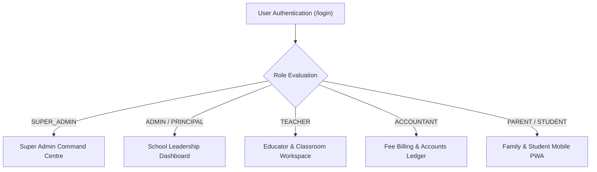

# SchoolMitra ERP — End-User Operations Manual & Role Playbooks

> **Document Classification**: User Manual & Operational Playbooks  
> **Target Audience**: School Principals, Administrators, Teachers, Accountants, Parents, Students  
> **Status**: Official Production Guide  
> **Version**: 2.0.0  
> **Last Updated**: October 2026

---

## 1. User Guide Overview

SchoolMitra ERP is designed with role-tailored workspaces. When users log in, the navigation interface dynamically configures to match their exact responsibilities and security clearance.

---

## 2. Platform Super Administrator Playbook

### 2.1 Workspace Access
- **URL**: `http://educore-alb-1749225371.ap-south-1.elb.amazonaws.com/super-admin`
- **Permissions**: Fleet-wide control, multi-school provisioning, platform analytics, DPDP compliance vault.

### 2.2 Standard Operating Procedures

#### SOP SA-01: Onboarding a New School
1. Log into the Super Admin dashboard using platform credentials.
2. Navigate to **School Management** in the primary sidebar.
3. Click the **+ New School** button in the top right.
4. Fill in the required parameters:
   - **School Name**: Official legal name of the educational institution (e.g., `St. Xavier's International School`).
   - **Subdomain Slug**: Unique lowercase identifier (e.g., `stxaviers` -> `stxaviers.schoolmitra.in`).
   - **Contact Email**: Principal or institutional administrative contact email.
   - **Subscription Tier**: Select tier (`STARTER`, `GROWTH`, `ENTERPRISE`) based on active student enrollment quotas.
5. Click **Provision School**. The platform generates the tenant entry, seeds core roles, copies default academic template profiles, and dispatches the activation link.

#### SOP SA-02: Tenant Workspace Impersonation (Support Mode)
1. In the **School Management** table, locate the target school.
2. Click **Actions (⋮)** -> **Access School Workspace**.
3. Select an audit justification reason (e.g., `Troubleshooting Fee Challan Generation - Ticket #402`).
4. Click **Proceed with Impersonation**.
5. The platform establishes an audited 30-minute session and opens the school dashboard with an amber **IMPERSONATION ACTIVE** banner.
6. When diagnostic work is concluded, click **Exit Impersonation** in the banner to return to the platform console.

#### SOP SA-03: DPDP Privacy Vault Audits
1. Navigate to **DPDP Privacy Vault** (`/super-admin/dpdp`).
2. Review platform-wide consent metrics, active data retention policies, and cross-school data principal access requests.
3. If an emergency security event occurs, log the formal statutory incident via the **Log Breach Incident** modal within the mandated 6-hour regulatory window.

---

## 3. School Principal & Institutional Administrator Playbook

### 3.1 Workspace Access
- **URL**: Institutional subdomain or primary portal login (`/admin` / `/principal`).
- **Permissions**: School-level master configurations, staff management, academic scheduling, calendar approvals.

### 3.2 Standard Operating Procedures

#### SOP AD-01: Initial Academic Year Setup
1. Open **Academics** -> **Academic Years**.
2. Click **Create Academic Year** (e.g., `2026-2027`).
3. Set the official session start date (e.g., `June 1, 2026`) and session end date (e.g., `May 31, 2027`).
4. Configure terms (e.g., `Term 1: June – October`, `Term 2: November – March`).
5. Set the new year as **Active**. All subsequent classes, sections, and student rosters will link to this active cycle.

#### SOP AD-02: Staff Member Onboarding
1. Navigate to **Staff & HR** -> **Staff Directory**.
2. Click **+ Add Staff Member**.
3. Enter employment details:
   - Full Name, Gender, Date of Birth, Emergency Contact.
   - Designation (e.g., `PGT Mathematics`) and Department (`Senior Secondary`).
   - Assign Primary Role (e.g., `TEACHER`, `ACCOUNTANT`, `LIBRARIAN`).
4. Set official joining date and assign salary grade template.
5. Provide login credentials; the staff member receives an automated activation email to set up their password.

---

## 4. Teacher & Educator Playbook

### 4.1 Workspace Access
- **URL**: Institutional subdomain (`/teacher`).
- **Permissions**: Classroom roll call, mark entry, lesson planning, student notes.

### 4.2 Standard Operating Procedures

#### SOP TC-01: Morning Attendance Roll Call
1. Log into the Educator Workspace.
2. Select your assigned **Class & Section** (e.g., `Class 10 — Section A`).
3. The register automatically loads enrolled students in alphabetical order by Roll Number.
4. **Fast Marking**:
   - Tap **Mark All Present** to initialize the roster.
   - Individually tap any absent students to toggle their status to **Absent** (red badge) or **Late** (yellow badge).
5. If a student has an approved medical leave, the system displays an indicator: **Medical Exemption Active**.
6. Review totals in the summary bar (Enrolled, Present, Absent, Late).
7. Tap **Submit Attendance Register**. The roll call is locked, and parent notification alerts are automatically queued for any absent students.

#### SOP TC-02: Exam Mark Entry & Submission
1. Navigate to **Examinations** -> **Mark Entry**.
2. Select the Exam (e.g., `Mid-Term Examination 2026`), Subject (e.g., `Physics`), and Section (`Class 10-A`).
3. Enter marks for Theory and Practical components. The form enforces maximum mark boundaries automatically.
4. Click **Save Draft** during entry, or click **Submit for Principal Review** once all entries are finalized.

---

## 5. Fee Accountant Playbook

### 5.1 Workspace Access
- **URL**: Institutional subdomain (`/accountant`).
- **Permissions**: Fee collection, invoice generation, discount waivers, bank reconciliation, ledger reports.

### 5.2 Standard Operating Procedures

#### SOP AC-01: Generating Term Invoices
1. Navigate to **Fees** -> **Fee Invoices**.
2. Click **Generate Batch Invoices**.
3. Select the Academic Term and target Classes (e.g., `All Primary Classes`).
4. Review calculated totals based on assigned Fee Structures (Tuition + Computer Lab + Transport).
5. Click **Issue Invoices**. Invoices appear immediately in parent portals and trigger SMS fee due slips.

#### SOP AC-02: Offline Fee Collection (Counter Cash / Cheque)
1. Open **Fees** -> **Collect Fee**.
2. Search for the student by Admission Number, Student Name, or Parent Phone.
3. Select the unpaid invoice items.
4. Choose the Payment Mode: **Cash**, **Cheque/DD**, or **Direct Bank Transfer (NEFT)**.
   - For Cheques: Enter Cheque Number, Bank Name, and Cheque Date.
5. Click **Receive Payment & Print Receipt**.
6. The system generates an official receipt with a unique serial number and double-entry ledger journal entry, then downloads the printable PDF.

---

## 6. Parent & Student Mobile PWA Guide

SchoolMitra provides a native-like Progressive Web App (PWA) installable directly onto mobile devices without needing the Google Play Store or Apple App Store.

### 6.1 Installation Guide

#### Android (Brave / Google Chrome / Samsung Internet)
1. Open your school link in your mobile browser:
   `http://educore-alb-1749225371.ap-south-1.elb.amazonaws.com`
2. When the bottom dialog appears:
   - Tap **"Create shortcut"** or **"Install app"**.
   - If no popup appears, tap the browser **Menu (⋮)** in the top right -> tap **"Add to Home screen"** or **"Install"**.
3. The high-resolution SchoolMitra icon will be placed on your phone's home screen.
4. Tapping the icon launches the app in full-screen standalone mode without any browser URL bar.

#### Apple iOS (Safari)
1. Open your school link in **Safari**.
2. Tap the **Share** button (the square icon with an upward arrow ⎚ at the bottom of the screen).
3. Scroll down and tap **"Add to Home Screen"** (**+**).
4. Tap **"Add"** in the top-right corner.
5. The SchoolMitra icon will appear on your iOS home screen, launching full-screen like a native app.

### 6.2 Key Features in Parent Portal
- **Real-Time Attendance**: Live notifications when morning roll call is marked.
- **Online Fee Payment**: One-click UPI, Google Pay, PhonePe, and Card payments with instant PDF receipts.
- **Report Cards**: Direct download of signed academic evaluation cards.
- **DPDP Privacy Rights**: Navigate to **Profile** -> **Data Privacy Rights** to inspect all personal information the school maintains and manage communication consent preferences.
